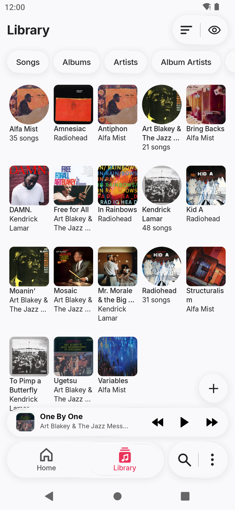
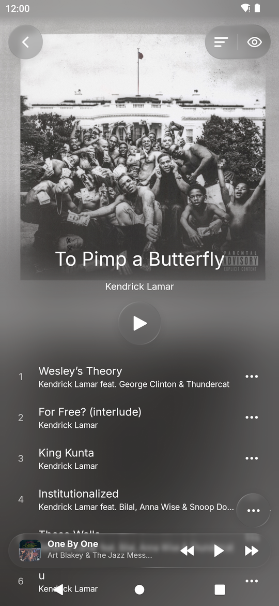
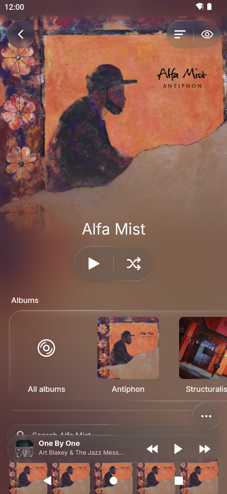
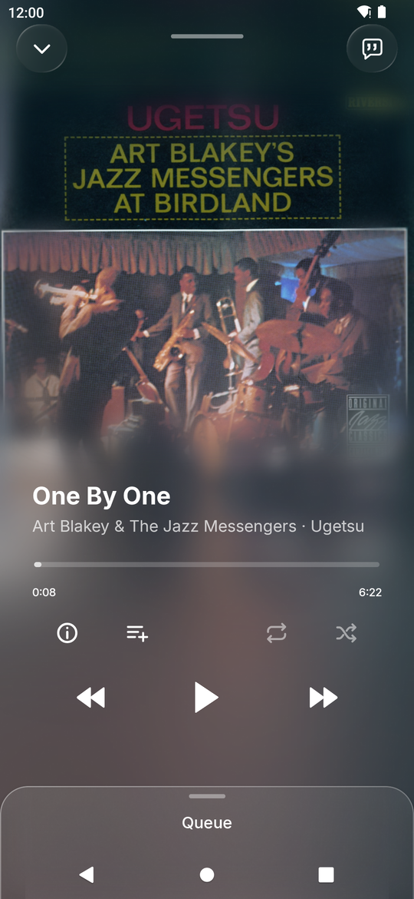
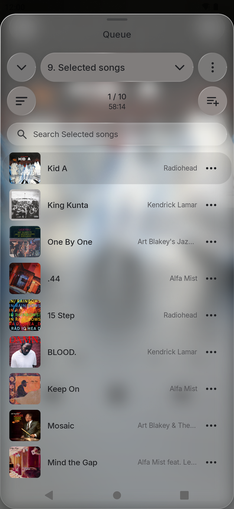
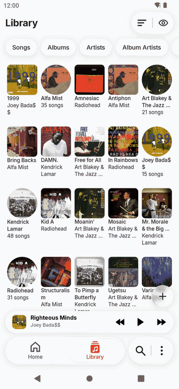

# Localica

An Android player for music stored on your device. Browse folders, albums and artists, organize playlists, and keep separate listening queues.

Saved queues, configurable navigation, bulk tag/artwork editing, local synced lyrics, and background playback. Core features work offline without an account. Optional Last.fm sync reads listening statistics by username. Liquid Glass floating controls complement a frosted Queue drawer.

Requires **Android 8+**. Supports MP3 and AAC/M4A, plus WAV, FLAC, Ogg, and Opus where the device provides a decoder. Songs advance through the active queue.

[Download development APKs](https://github.com/anastaci1a/localica/releases) · [Build and test](docs/development/build.md) · [Project plan](docs/README.md) · [Report an issue](https://github.com/anastaci1a/localica/issues)

[Documentation](docs/README.md) · [Interface contract](docs/interface/materials-and-controls.md) · [Contributing](agents/README.md)

<table>
  <tr>
    <td align="center"> Library</td>
    <td align="center"> Album</td>
    <td align="center"> Artist</td>
    <td align="center"> Player</td>
    <td align="center"> Queue</td>
  </tr>
</table>

Previews captured in v0.30.3 using silent demo files. Album artwork and track names come from albums by Radiohead, Kendrick Lamar, Alfa Mist, Art Blakey & The Jazz Messengers and Joey Bada$$. The lyrics are from Joey Bada$$’s “Righteous Minds”. Artwork and lyrics belong to their respective rights holders and are not included in the app.
