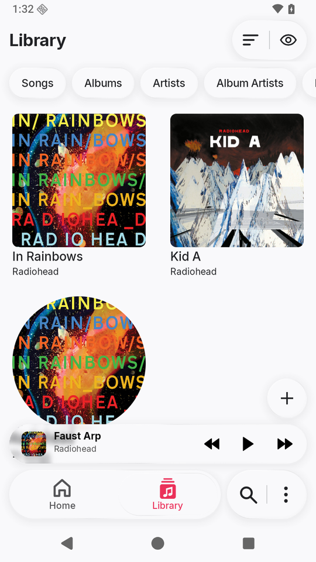
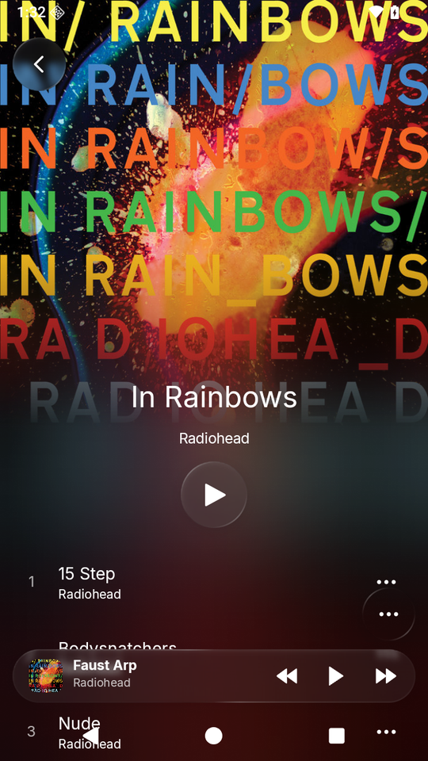
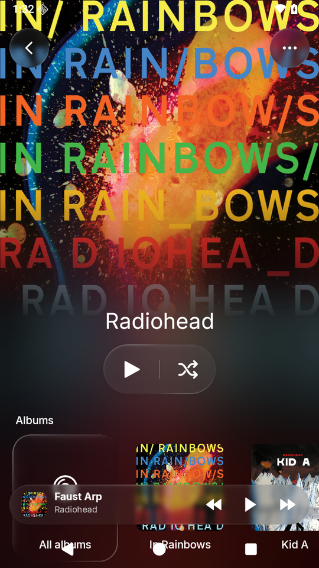
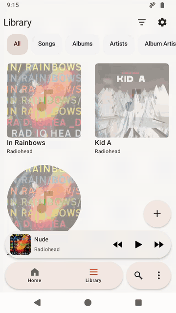

# Localica

An Android player for music stored on your device. Browse folders, albums and artists, organize playlists, and keep separate listening queues.

Saved queues, configurable navigation, bulk tag/artwork editing, local synced lyrics, and background playback. No account or internet access. Liquid Glass floating controls complement a frosted Queue drawer.

Requires **Android 8+**. Supports MP3 and AAC/M4A, plus WAV, FLAC, Ogg, and Opus where the device provides a decoder. Songs advance through the active queue.

[Download development APKs](https://github.com/anastaci1a/localica/releases) · [Build and test](docs/build.md) · [Project plan](docs/README.md) · [Report an issue](https://github.com/anastaci1a/localica/issues)

[Liquid Glass field guide](docs/liquid-glass/README.md): Apple research, Localica’s material and motion specification, and interactive studies.

  
  
  
  
  

  
Watch a short navigation preview

  

Previews captured in v0.25.0 using silent demo files. Album artwork and track names: Radiohead’s [In Rainbows](https://radiohead.bandcamp.com/album/in-rainbows) and [Kid A](https://radiohead.bandcamp.com/album/kid-a). Artwork belongs to its respective rights holders and is not included in the app.
