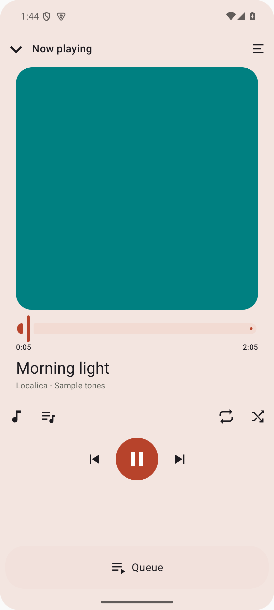
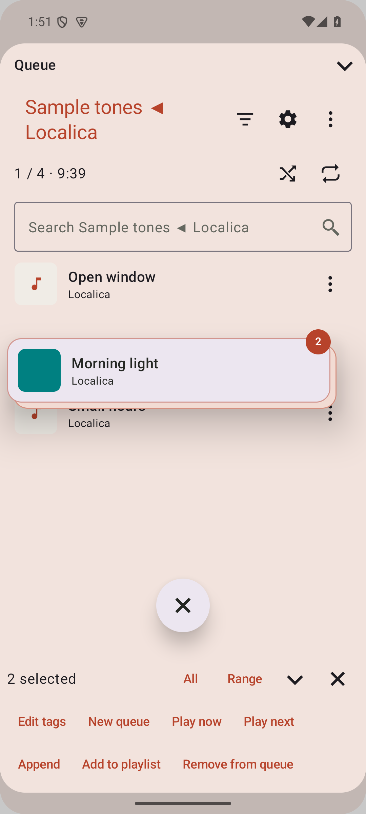
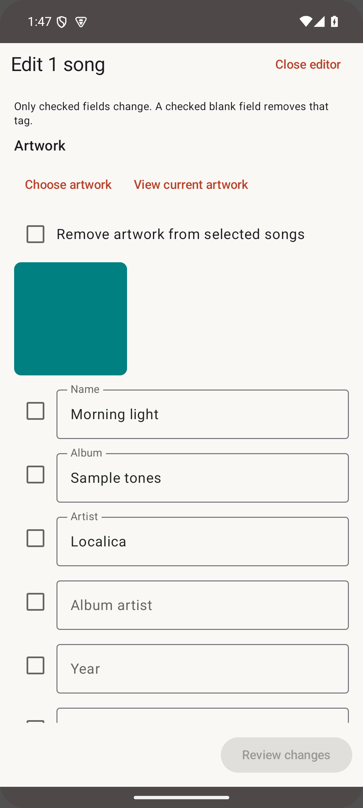

# localica

An Android player for music stored on your device. Browse folders, albums and artists, organize playlists, and keep separate listening queues.

Saved queues, configurable navigation, bulk tag/artwork editing, local synced lyrics, and background playback. No account or internet access. The lasting layout is taking shape with simple materials; liquid-glass styling comes later.

Requires **Android 8+**. Supports MP3 and AAC/M4A, plus WAV, FLAC, Ogg, and Opus where the device provides a decoder. Songs advance through the active queue.

[Download development APKs](https://github.com/anastaci1a/localica/releases) · [Build and test](docs/build.md) · [Project plan](docs/README.md) · [Report an issue](https://github.com/anastaci1a/localica/issues)

  
  
  

Screenshots use original synthetic demo audio and lyrics.
