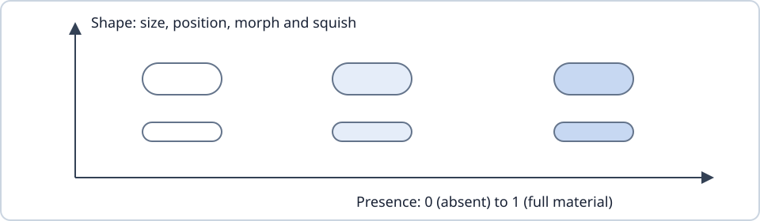

# Glass

Glass is one material drawn by one of two renderers: Normal (lens) or None (flat fills). Proposed: every glass element has a presence, from 0 to 1, and a shape. Glass appears by raising presence and disappears by lowering it, never by fading. Press, squish and morph change shape only. Each renderer shows what it can.

- Presence scales every material property. Shape is geometry: size, position, morph, squish and thickness.
- Constant volume (Proposed): thickness is derived as resting volume divided by footprint area.
- The optics formula is frozen. Only its inputs change over time.
- The lens needs Android 13 or newer. Older versions draw the average colour.
- Status: renderers and fallbacks are Implemented. Presence, constant volume and lensing in (#928) and touch light (#642) are Proposed.

A third renderer, Single-Tone Blur, existed up to v0.34.2 as a testing mode. Its removal (#919) is Released in v0.34.3, and stored choices migrate to Normal. This page does not describe it.

## Renderers

| Renderer | Material |
| --- | --- |
| Normal, Android 13+ | Padded AGSL refraction, illuminated rim and tone mapping over recorded scenes. |
| Normal, older Android | Coverage-weighted scene average with tint/contrast and the same outline; no refraction or blur. |
| None | Opaque white/dark-grey fills without glass recording, sampling, atlas or readback. |

Shapes, shadows, input and motion are shared. Frosted panels use downsampled scattering on Android 12+; refracting glass requires Android 13+. Foregrounds and clear glass stay full-resolution.

## Presence and shape

The diagram separates material strength (presence, 0–1) from geometry (shape). Proposed in #928: appearance changes presence; presses, squish and morph change shape. Lens strength uses presence and thickness; None uses fill opacity. At zero presence all renderers match their background. Fallbacks ignore thickness.

Implemented appearance instead uses scale/opacity at full optical strength. It does not yet ramp lens inputs.

### Constant volume

Proposed: thickness derives from resting volume and footprint area:

$$
t = \frac{V_{\mathrm{rest}}}{A_{\mathrm{footprint}}}
$$

Spreading thins the material. Morphing changes resting volume between shapes; it is not a press deformation. Presence alone changes material quantity. Current press thickness/growth remain independent.

## The lens model

One outline serves clipping, refraction, illumination and shadow. Foreground polarity is explicit, requiring no ink readback. Resting depth defaults to 1.35; menu controls/mini-player use 1.3×, tab shelf 0.72×. Trigger depth carries into its popup. Optics remain frozen outside milestone M6; exact changes require pixel equality.

## What glass samples

Recorded browsing, panel, list, player and lyric scenes stay separate to avoid cycles. Inline glass excludes itself; nested panels sample completed parents. One live recording-local mapping handles crop and clip, including scroll/scale. Non-finite, singular or projective mappings are rejected. Popup return follows its live trigger footprint.

Sampling leases retain shared scenes; scrolling display lists let narrow crops cull hidden rows. Unreferenced scenes skip readback, and pending native copies retain live producers. Registration/continuity tests specify coordinate and ownership transitions.

### The average fallback

Progressive halving produces shared 32×32 thumbnails. The coverage-weighted region uses its own source and parent beyond that box, stopping at scene edges. No full-resolution CPU capture is required. Apart from raster quantization, mean error is bounded by boundary-cell area fraction times maximum channel contrast.

## Sliders and switches

Resting white thumbs hold no lease. Normal contact captures only the procedural neighbourhood and refracts inside the shared geometry. None keeps geometry/motion with opaque fills. Explicitly eligible panel-contained controls use an 8×8 local GPU average on Android 13+.

## Backings and selectors

Backings stay viewport-bounded; released/unrecorded layers cannot read back. Queue frost is independent of floating glass. Navbar selectors sample bar material; optional overlays include labels/icons without double drawing. Graphics remain independent of storage/playback.

## Tests

[GlassRenderModesTest](../../app/src/androidTest/java/io/github/anastaci1a/localica/GlassRenderModesTest.kt).

[GlassRendererSwitchingTest](../../app/src/androidTest/java/io/github/anastaci1a/localica/GlassRendererSwitchingTest.kt).

[FlatNoneMaterialTest](../../app/src/androidTest/java/io/github/anastaci1a/localica/FlatNoneMaterialTest.kt).

[GlassOpticsTest](../../app/src/androidTest/java/io/github/anastaci1a/localica/GlassOpticsTest.kt).

[LiquidGlassTest](../../app/src/androidTest/java/io/github/anastaci1a/localica/LiquidGlassTest.kt).

[NestedGlassRegistrationTest](../../app/src/androidTest/java/io/github/anastaci1a/localica/NestedGlassRegistrationTest.kt).

[BackdropProducerContinuityTest](../../app/src/androidTest/java/io/github/anastaci1a/localica/BackdropProducerContinuityTest.kt).

[BackdropInvalidationTest](../../app/src/androidTest/java/io/github/anastaci1a/localica/BackdropInvalidationTest.kt).

[HeaderGlassFreshnessTest](../../app/src/androidTest/java/io/github/anastaci1a/localica/HeaderGlassFreshnessTest.kt).

[SelectorRegistrationTest](../../app/src/androidTest/java/io/github/anastaci1a/localica/SelectorRegistrationTest.kt).

[CollectionControlsBackdropTest](../../app/src/androidTest/java/io/github/anastaci1a/localica/CollectionControlsBackdropTest.kt).

[GlassToneShaderParityTest](../../app/src/androidTest/java/io/github/anastaci1a/localica/GlassToneShaderParityTest.kt).
