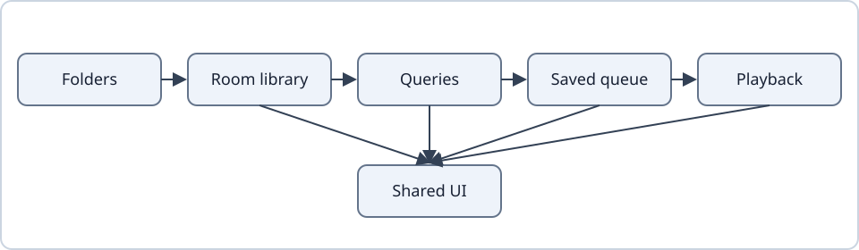

# Architecture overview

Localica is one Kotlin and Compose `app` module with constructor injection. Files become a Room library. Queries turn the library into lists. A queue is a saved list of occurrences. One service plays the active queue. Storage and playback never depend on Compose or graphics.

- Each concern has one owner and one page in this folder.
- Disk, decoding and queries run off the main thread. The main thread only presents results.
- Source code owns numbers that can be tuned. Documentation keeps the rules and their reasons.
- Add an interface or a module only for a boundary that already exists in practice.

The diagram reads left to right: granted folders are scanned into the library database; shared queries build browse lists; tapping a song snapshots a list into a queue; the playback service plays that queue; the UI system draws every stage.

## Packages

Paths are under `app/src/main/java/io/github/anastaci1a/localica/`.

| Package | Responsibility | Page |
| --- | --- | --- |
| `library`, `browse` | Document access, indexing, shared queries, grouping, filters and view preferences. | [Library](library.md) |
| `scanner`, `editing`, `lyrics` | Background scans, recoverable writes, image selection, local lyric discovery and parsing. | [File editing](file-editing.md) |
| `queue`, `playlist` | Durable occurrence-based collections, serialized commands and imports. | [Queues](queues.md) |
| `playback`, `statistics` | The Media3 service and controller, listening time, qualified plays and ranking counts. | [Playback](playback.md) |
| `artist`, `artistphoto`, `lastfm`, `network` | Artist projections, photo providers and cache, read-only statistics sync, online consent. | [Online](online.md) |
| `navigation`, `home` | Restorable typed routes and preferences; typed pins and their manual order. | [Navigation](../interface/navigation.md) |
| `icons` | Built-in icons and imported packs. | [Icon packs](../icon-packs.md) |
| `diagnostics` | The in-memory diagnostics trail and its export. | [Testing](../development/testing.md#field-diagnostics) |
| `ui` | Views, gestures and materials, built on the shared UI system. | [UI system](ui-system.md) |

`app/src/test` holds fast behaviour tests. `app/src/androidTest` covers real Android storage, UI and playback. The `lint` module holds the UI policy rules.

## Threads

| Work | Owner |
| --- | --- |
| Scans, tag writes, provider listing | Foreground services and one file-operation lock, off the main thread. |
| Queue and playlist changes | One controller per collection type, which serializes transactions. |
| The player | The playback service alone. Other code sends commands. |
| Queries, search index, statistics overlays, artwork decode | Background workers that publish immutable results. |
| Motion and drawing | The UI engine's frame clock on the main thread. |

No disk wait blocks the main thread. A result is published only when it still matches the request that asked for it, so a stale answer never replaces a newer one.

## Settings and selection

Preferences are typed. A scoped preference keeps explicit inheritance: it is either its own value or "follow the parent". Shared enum decoding maps an unknown stored value to a safe default, so an older or newer build can read the same file.

Selection stores source occurrence identities and clears only after its command completes. Home pins keep typed identity and manual order, independent of tabs. Pure ordering and move helpers are shared by every collection type.

Tests: `EnumDecodingTest`, `QueuedSettingsTest`.

## Where to go next

| Question | Page |
| --- | --- |
| How is the interface built and policed? | [UI system](ui-system.md), [Popups](popups.md), [Motion](motion.md), [Glass](glass.md), [Rendering](rendering.md) |
| How do edits stay safe? | [File editing](file-editing.md) |
| Why does a track boundary sound right? | [Audio corrections](audio-corrections.md) |
| What does the user see? | The [interface pages](../README.md#interface) |
