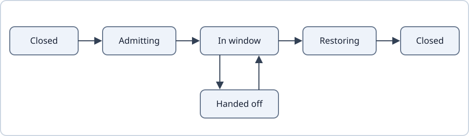
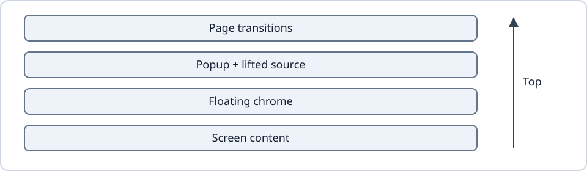

# Popups

A popup is one glass surface that grows out of its trigger and returns into it. Proposed: each popup has one phase, written in one place: closed, admitting, in its window, restoring, or handed off. One function turns that phase into who draws, what the glass samples, and who takes touch. Trigger differences are data, not branches.

- Implemented: every popup is drawn by shared owners, opens from a trigger and returns to it as one visible surface, on the shared [motion](motion.md) law.
- Proposed (#920): the single phase and the single presentation function. Today the same facts are spread over many flags.
- Proposed (#927): one top popup layer, with lift-and-drop of the source.
- Released in v0.34.2 (#926): closing uses the main law on every edge. The fix that keeps a plain close above bottom chrome is Incomplete.
- Screens never own a popup home, window or trigger. The [lint gate](ui-system.md#the-lint-gate) enforces it.

## Terms

A trigger is the opening control; its home is the screen layer that can draw retained popup pixels. The native window hosts the open surface. Handoff transfers drawing to the opening screen, carrying its movement, fade and clip. Sampling basis means backdrop plus coordinate mapping.

## Lifecycle

Proposed: Closed → Admitting → In window → Restoring → Closed. Handoff is a side state where the opening screen draws the surface. Admission prepares the window before hiding the trigger; restoration keeps drawing until visible-trigger acknowledgement.

One phase/writer would replace flags that let readers disagree about ownership. Phase-local waits cancel on exit and have bounded completion. Trigger differences become policy data.

Implemented invariants: hidden triggers take no input; dismissal releases input before exit drawing ends; visible restored triggers can reverse immediately. Retained surfaces reclaim drawing/shadow without cooldown. Destination pages never inherit another screen's popup. Native receipts finish disposal/return. Ownership and handoff tests below specify interruptions.

## Layers and lift-and-drop

Proposed (#927): screen content, floating chrome, popup/source layer, then page transitions. The source lifts with the popup and drops only after return completes. Sampling excludes the popup and its source. Anchored/centred placement is data; shared motion owns opening and closing.

## Windows and the modal stack

Caller theme/view/focus locals are restored before window creation and remain through exit. Nested windows sample completed parents. One modal stack cancels/quarantines lower pointer streams, stops scrolling and rejects stale flings across recreation. App scrims avoid invisible native dim surfaces blocking return input.

## Material and ink

Trigger and popup share one continuous material, deformation, corners and optics. Explicit trigger ink wins, then launching appearance, then ambient ink. Recorded sources blend before handoff without discarding rebound. Grouped shadows match at home and separate while opening. [Glass](glass.md#what-glass-samples) owns sampling.

## Size, keyboard and chrome

Content measures glass; padded backdrops fit separately. Shared ui.spec presets and PopupViewportSlot own insets, placement and keyboard measurement. Fixed dialogs retain height; content-sized dialogs ease it. Retargeting keeps position/velocity. Morph faces place destination children only. Scroll fades affect overflowing body edges, excluding shell/title/footer. [Search](../interface/search-and-sort.md) keeps its field unscaled/top-aligned. Window, slot and keyboard tests specify geometry.

## Tests

[PopupHostNavigationTest](../../app/src/androidTest/java/io/github/anastaci1a/localica/PopupHostNavigationTest.kt).

[PopupParentPendingHandoffTest](../../app/src/androidTest/java/io/github/anastaci1a/localica/PopupParentPendingHandoffTest.kt).

[GlassMorphTest](../../app/src/androidTest/java/io/github/anastaci1a/localica/GlassMorphTest.kt).

[MorphFacesTest](../../app/src/androidTest/java/io/github/anastaci1a/localica/MorphFacesTest.kt).

[PopupWindowHostContractTest](../../app/src/androidTest/java/io/github/anastaci1a/localica/PopupWindowHostContractTest.kt).

[PopupViewportSlotTest](../../app/src/androidTest/java/io/github/anastaci1a/localica/PopupViewportSlotTest.kt).

[PopupImeGeometryTest](../../app/src/androidTest/java/io/github/anastaci1a/localica/PopupImeGeometryTest.kt).

[PopupEditorFocusOwnershipTest](../../app/src/androidTest/java/io/github/anastaci1a/localica/PopupEditorFocusOwnershipTest.kt).

[PopupScrollEdgesTest](../../app/src/androidTest/java/io/github/anastaci1a/localica/PopupScrollEdgesTest.kt).

[PopupRimTest](../../app/src/androidTest/java/io/github/anastaci1a/localica/PopupRimTest.kt).

[DialogChromeLayoutTest](../../app/src/androidTest/java/io/github/anastaci1a/localica/DialogChromeLayoutTest.kt).

[PopupHomeShapeTest](../../app/src/androidTest/java/io/github/anastaci1a/localica/PopupHomeShapeTest.kt).

[PopupShadowContinuityTest](../../app/src/androidTest/java/io/github/anastaci1a/localica/PopupShadowContinuityTest.kt).
