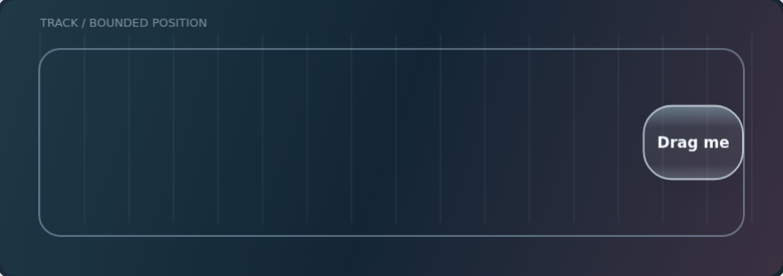
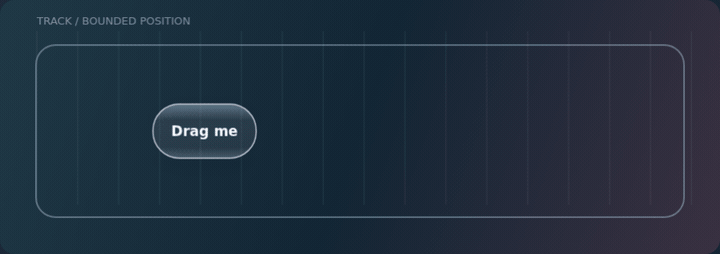
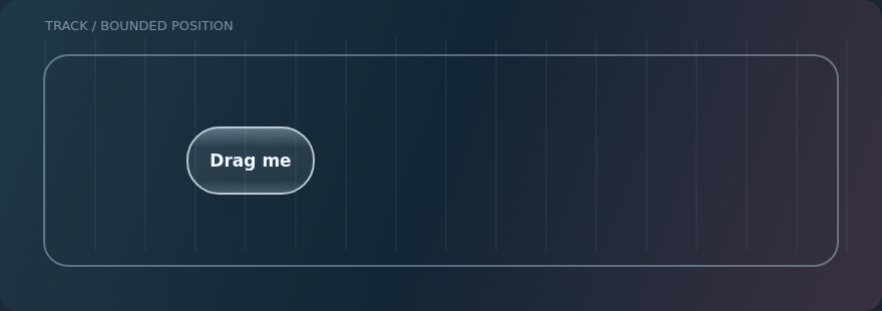

# The Liquid Glass field guide

**An Apple-sourced design reference for Localica.** How surfaces should respond, how light establishes their shape, and how to keep the result readable and fast.

[Apple evidence](sources.md) · [Localica specification](specification.md) · [Interactive motion lab](lab.html) · [Project docs](../README.md)

## Choose a path

| I want to… | Start here |
| --- | --- |
| Understand the feeling we are aiming for | [Fluid interaction foundations](sources.md#interaction-foundations) |
| Check what Apple actually says | [Evidence atlas with video timestamps](sources.md) |
| See our implementation rules | [Localica specification](specification.md) |
| Drag, reverse and press against an edge | [Motion lab](lab.html) — download/open locally; GitHub shows its source |
| Review motion without running anything | Expand the demonstrations below |
| Check what the app currently promises | [Current interface contract](../interface.md) |

The guide separates **Apple evidence**, **Localica models**, and **shipped behavior**. It is a research reference, not a claim of pixel-identical iOS rendering.

## Motion studies

These original illustrations use the lab's simple spring/strain model. They demonstrate interaction ideas, not Apple's renderer or the Android app. The static image above provides a motion-free alternative; animations remain inside opt-in sections.

Boundary pressure and recovery

The target stays bounded. Shape communicates the remaining pressure. Compare with [shape carries impact](specification.md#shape-carries-impact).

One surface changes its shape

A persistent identity connects the two sizes. The production design also needs matching optics, shadow, content and focus. See [input and motion](specification.md#input-and-motion).

## Read this before using the rules

The specification defines the shared system and its acceptance checks. Physical-device performance still needs review; optical materialization remains deferred. Current selection lenses intentionally appear immediately; their entrance motion awaits [#107](https://github.com/anastaci1a/localica/issues/107). Requested glass-on-content and nested controls remain explicit departures from Apple's usual layer guidance.

The guide was compiled from primary sources before its illustration/formatting pass. Sources were reviewed on **12 October 2026**. Update the relevant evidence and specification together when Apple's guidance or our design decisions change; keep release history in Git and Releases. The lab and diagrams are original project assets, with no Apple video frames or font files included.

[Main repository](../../README.md) · [Evidence atlas](sources.md) · [Acceptance checks](specification.md#acceptance-checks)
