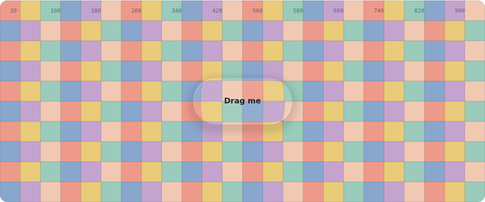
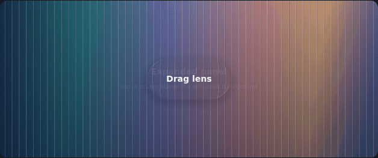

# The Liquid Glass field guide

**An Apple-sourced design reference for Localica.** How surfaces should respond, how light establishes their shape, and how to keep the result readable and fast.

[Apple evidence](sources.md) · [Optical findings](optics.md) · [Localica specification](specification.md) · [Interactive controls](controls.md) · [Live lab](https://anastaci1a.github.io/localica/liquid-glass/lab.html) · [Project docs](../README.md)

## Choose a path

| I want to… | Start here |
| --- | --- |
| Understand the feeling we are aiming for | [Fluid interaction foundations](sources.md#interaction-foundations) |
| Check what Apple actually says | [Evidence atlas with video timestamps](sources.md) |
| See our implementation rules | [Localica specification](specification.md) |
| Design settings, sliders, switches and buttons | [Control roles, states and review exercises](controls.md) |
| Drag, reverse, refract and change material parameters | [Live WebGL lab](https://anastaci1a.github.io/localica/liquid-glass/lab.html) — runs in your browser |
| Check measured displacement and model limitations | [Optical findings and reproducible experiments](optics.md) |
| Review motion without running anything | Expand the demonstrations below |
| Check what the app currently promises | [Current interface contract](../interface.md) |

The guide separates **Apple evidence**, **Localica models**, and **shipped behavior**. It is a research reference, not a claim of pixel-identical iOS rendering. The [hosted field guide](https://anastaci1a.github.io/localica/liquid-glass/) has the same notes and navigable links.

## Refraction study

The lab samples an original backdrop through two selectable inverse-map models. Compare edge displacement, thickness, blur, contrast and synthetic reflection independently. Its coordinate diagnostic and reproducible browser tests check actual shader output. [Run and verify](optics.md#run-and-verify).

Actual shader morph, captured at fixed simulation steps

Original WebGL output; deterministic 30 Hz simulation captures, not a phone frame-rate measurement or an Apple reference.

## Motion studies

These earlier original illustrations explain the spring/strain idea with simple gradients. They predate the refracting lab above and do not show production optics. Animations remain inside opt-in sections.

Boundary pressure and recovery

The target stays bounded. Shape communicates the remaining pressure. Compare with [shape carries impact](specification.md#shape-carries-impact).

One surface changes its shape

A persistent identity connects the two sizes. The production design also needs matching optics, shadow, content and focus. See [input and motion](specification.md#input-and-motion).

## Read this before using the rules

The specification defines the shared system and its acceptance checks. Physical-device performance still needs review; optical materialization remains deferred. Current selection lenses intentionally appear immediately; their entrance motion awaits [#107](https://github.com/anastaci1a/localica/issues/107). Requested glass-on-content and nested controls remain explicit departures from Apple's usual layer guidance.

Update evidence and specification together when guidance or owner decisions change; source review dates live in the [atlas](sources.md). Keep release history in Git and Releases. The lab and diagrams are original project assets; no Apple video frames or font files are included.

[Main repository](../../README.md) · [Evidence atlas](sources.md) · [Acceptance checks](specification.md#acceptance-checks)
