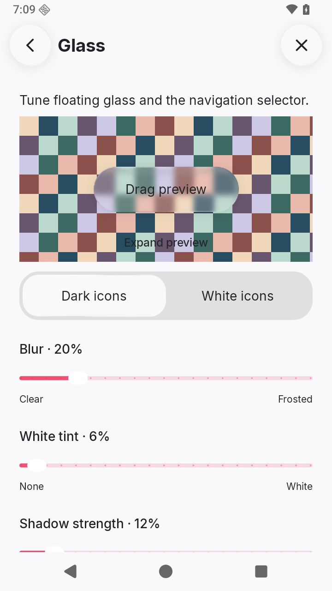

# Controls that stay under your finger

[Guide home](README.md) · [Apple evidence](sources.md#choosing-and-arranging-controls) · [Material and motion](specification.md) · [Motion lab](lab.html)

**Localica implementation rules, grounded in Apple's control guidance.** Choose the interaction first, then give it glass. The shape, optical response and semantic value must describe the same state. These rules are acceptance targets; the [interface contract](../interface.md) describes the app's current behavior.

## Choose the control

| Intent | Control and layout | Localica rule |
| --- | --- | --- |
| Perform an action | Button with a short verb or familiar symbol | Give contact feedback immediately; activate on valid release. Dragging away cancels activation but retains visual pressure until release. Keep destructive actions distinct from the ordinary primary action. |
| Turn something on/off | Switch at the trailing end of a descriptive row | Make the row tappable and expose one switch to accessibility. Thumb position communicates state as well as track color. A gesture previews the thumb; release commits, cancellation restores the existing state. |
| Pick one of a few related values | Consistent, equally sized segments | Use inline segments for 2–3 choices when measured labels fit. Keep commands separate from settings. |
| Switch closely related views | Segmented tabs with a persistent header | Use tab semantics. Sort/View changes the editor beneath it, retaining one shared draft; the choice controls within that editor use selection semantics. |
| Adjust a bounded quantity | Slider with a label, current value and meaningful endpoints | Track continuously and expose the range/steps to accessibility. Snap only when the setting is discrete. Preserve native keyboard adjustment. Offer a precise entry method when the range requires it. |
| Choose from a long set | Contextual choice list/picker | Stage a draft until Select; Cancel discards it. Both actions sit at bottom right. An enclosing editor retains its separate Save action. |
| Enter text or an exact number | Labeled field; appropriate keyboard | Keep the label after typing begins, preserve the draft on Back, and report invalid values near the field. Let long labels wrap without escaping the surface. |

Apple's examples favor clear hierarchy and restraint: related buttons have consistent sizing, while prominence comes from treatment rather than an arbitrary size jump. The HIG generally recommends a 44-point iOS button target; Localica retains its **48 dp minimum Android target**. These units and platform conventions are not interchangeable. See the linked [HIG evidence](sources.md#choosing-and-arranging-controls).

## One interaction, several visual states

| State | Input and value | Surface response |
| --- | --- | --- |
| Rest | The committed value is unambiguous | Quiet shape; no running animation clock. State remains understandable without refraction or color alone. |
| Contact | The existing tap/drag recognizer still owns activation | Immediate bounded flattening and optical depth change. No queued “press animation” that must finish first. |
| Tracking | Preserve the grabbed point; allow reversal | Position follows input. Changes in momentum drive width/height/depth together; the material samples the track/content beneath it. |
| Limit | The value stays at its valid endpoint | The contacting edge stays pinned. Additional pull increases compression with diminishing response; it cannot advance the value beyond the range. |
| Release | Commit according to the control's meaning | Value/action takes effect before the rebound finishes. Continue from the current geometry; a new interaction can interrupt settling. |
| Cancel | Release outside a button, cancel a drag, or receive system cancellation | Remove contact/pressure and recover. A switch/choice restores its committed value. A continuously updating settings slider keeps its last valid value; the playback scrubber has its own explicit cancel-to-live-position rule. |
| Disabled | No activation or adjustment | Expose disabled semantics and a quiet disabled appearance. Do not react with an active press deformation. |

The general [spring/strain model](specification.md#shape-carries-impact) owns the equations. Control implementations supply position, contact, pressure and orientation; they must not each invent a separate bounce. User damping affects shape recovery, while travel remains constrained. The faster-motion preference changes pacing without creating positional overshoot.

## Sliders: keep the value visible

Apple's WWDC25 demonstration enlarges the thumb into a transparent rounded lens during manipulation, revealing the colored track endpoint beneath it. Its resting thumb is quieter and white. Localica uses opaque white resting thumbs and a clear, unblurred active lens. The active lens ignores ordinary glass appearance settings; its expansion is configurable from 1–2× (default 1.75×). Release continuously restores the white finish, then stops refraction work. [Demonstration and observations](sources.md#sliders-and-switches--wwdc25).

- Use a wide rounded rectangle, a continuous thin track, and crisp nearby value text. Keep the endpoint clear of blur, white plates and contrast coating. Render track and lens as one scene: identity outside, refraction inside, with one shared center and no independently positioned cutout. Keep tick centers inside rounded end caps.
- A thumb grab immediately owns the gesture until release, including initial vertical motion, and preserves its offset. A tap elsewhere on the track can choose a new value using the platform slider behavior; pressure must start from that new location, not the previous value.
- One coordinate model owns fill, thumb travel, values, endpoint labels and boundary compression. Round discrete values to the nearest stop; continuous values reach both limits at the visible track endpoints. Horizontal ranges run from logical leading minimum to trailing maximum, including right-to-left layouts. Vertical ranges run from bottom minimum to top maximum.
- Discrete controls expose ticks and matching accessible increments, with strong shared magnetic wells between valid stops. Percentage settings use 5% increments; other continuous ranges retain their precision. Thumb motion may preview travel between stops while the saved value stays valid.
- Reduced Motion keeps direct tracking and state changes, but removes decorative strain and depth changes. Do not substitute a blur animation for the removed movement.

The playback track remains a separate thumbless-at-rest control. Dragging it previews a seek; its shared X target explicitly cancels that preview without pausing playback. Do not silently apply that rollback behavior to every settings slider.

See the controls in Localica

An actual app capture on Android 16. The still image shows the resting controls and layout; use the exercises below to review interaction.

## Switches and moving choice lenses

Switches use a colored capsule track and a rounded thumb. The thumb becomes clear while manipulated or travelling; its quiet white rest finish returns continuously. An interrupted move begins at the visible position. Preserve one semantic on/off value while a drag previews the potential destination; commit once on release. Keep tap and keyboard alternatives equivalent.

Choice lenses use the same motion body and magnetic mapping in either orientation, including navigation following a manually swiped page. Pressing another option retargets immediately. At an endpoint, pin the touching edge and cap cross-axis expansion to the container's inset. Reversal/cancellation cannot strand the lens. For fitted navigation tabs, further overdrag also stretches the outer pill toward the pull, fixing its opposite edge and reducing height/depth.

Use one backdrop and avoid a second shadow for an inner thumb/lens when its parent already supplies the control's elevation. Foreground text stays sharp and outside the optical filter. The [surface-role exceptions](specification.md#surface-roles) still apply: Localica's user-requested nested glass is not Apple's general recommendation.

## Buttons and their destinations

A button's visible shape, press feedback, touch target and accessible action belong to one control. For non-draggable glass buttons, visual pressure persists when the initiating finger leaves the target and ends on lift/system cancellation. Activation remains independent: releasing outside or losing the tap to a parent gesture must not invoke the action.

For a morphing button, keep the same material identity, source tint and outline throughout expansion and return. A useful destination must not wait for a preliminary bounce. A dismissed panel stops owning input promptly; its visual return may continue while another control responds. Nested destinations return to the persistent ancestor trigger when their temporary source has closed.

Use deeper glass for an expanding trigger and flatter glass for a stationary navigation strip, as specified in the [interface contract](../interface.md#shared-controls-and-motion). Keep ordinary song overflow icons plain at rest. Repeat/shuffle retain the requested icon-only state feedback rather than adding filled hitboxes. Those are intentional product choices, even when a general Apple example uses another treatment.

## Review in motion

| Exercise | What must remain true |
| --- | --- |
| Tap, hold, slide outside, release | Immediate response, cancelled activation, no lingering pressed shape |
| Slow drag, flick, reverse, then re-grab | Distinct momentum response; no teleport or input lock |
| Hold beyond each endpoint | Value stays valid; contacting edge stays fixed; compression saturates |
| Cancel a switch/choice drag | No value callback; lens returns to the committed option |
| Tap the far end of a slider, then overdrag | Pressure corresponds to the new value, including RTL |
| Keyboard/TalkBack adjustment | Same values, steps and labels as touch; one meaningful control |
| Large text, narrow window, long labels | Value and meaning stay readable; targets do not overlap |
| Reduced Motion and disabled state | Useful state remains clear without misleading deformation |
| Leave a settings page and return | Persisted values match the last committed user choice |

Use actual app captures and both supported Android rendering paths. An illustrative lab demonstrates a model; it cannot establish production frame rate, accessibility correctness or optical fidelity.

[Apple references](sources.md#choosing-and-arranging-controls) · [Shared physics](specification.md#input-and-motion) · [Guide home](README.md)
