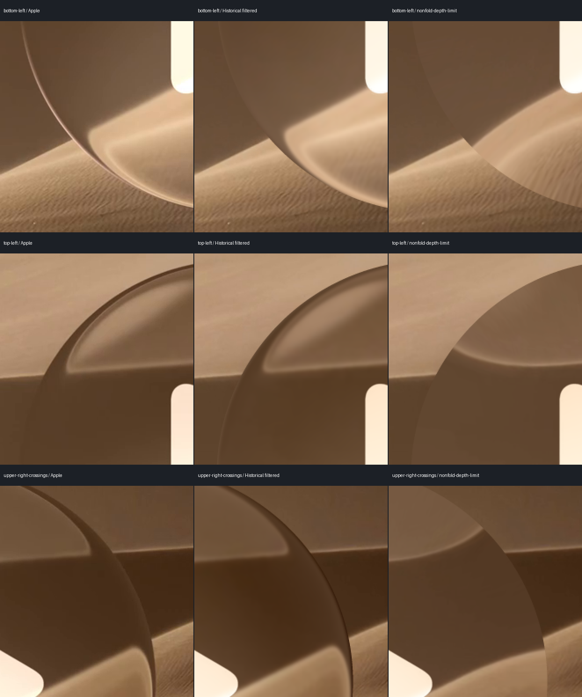
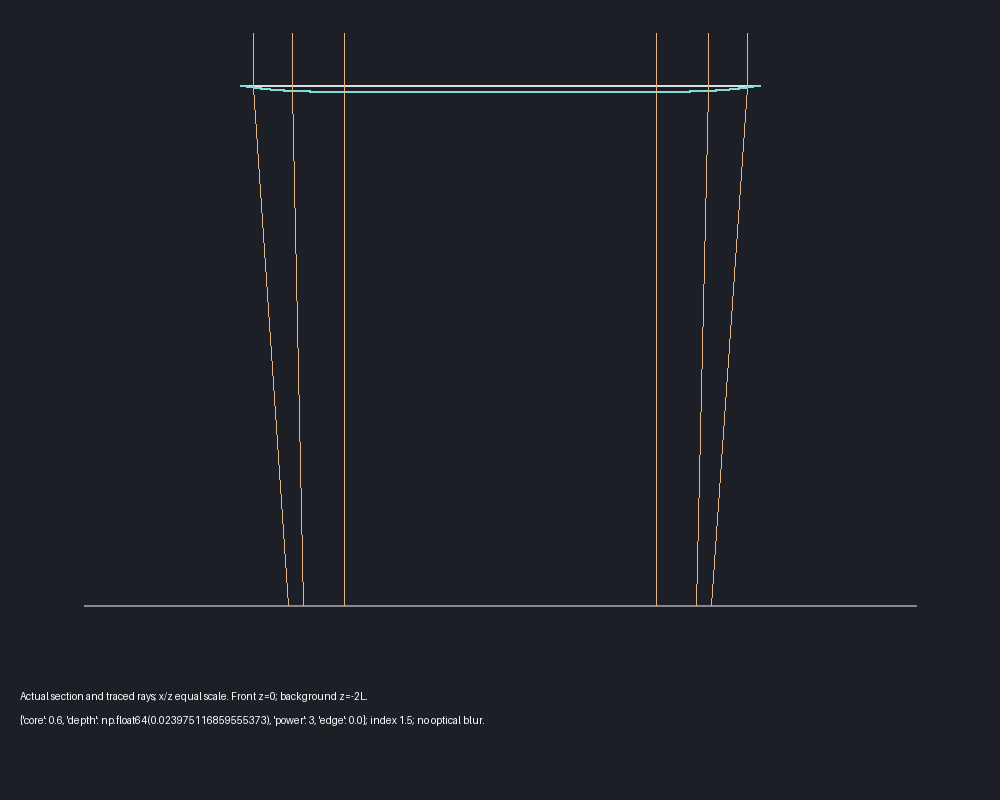
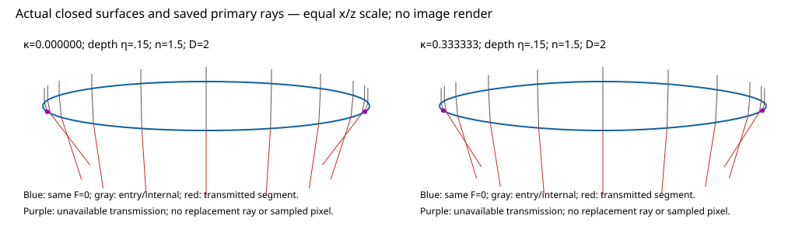
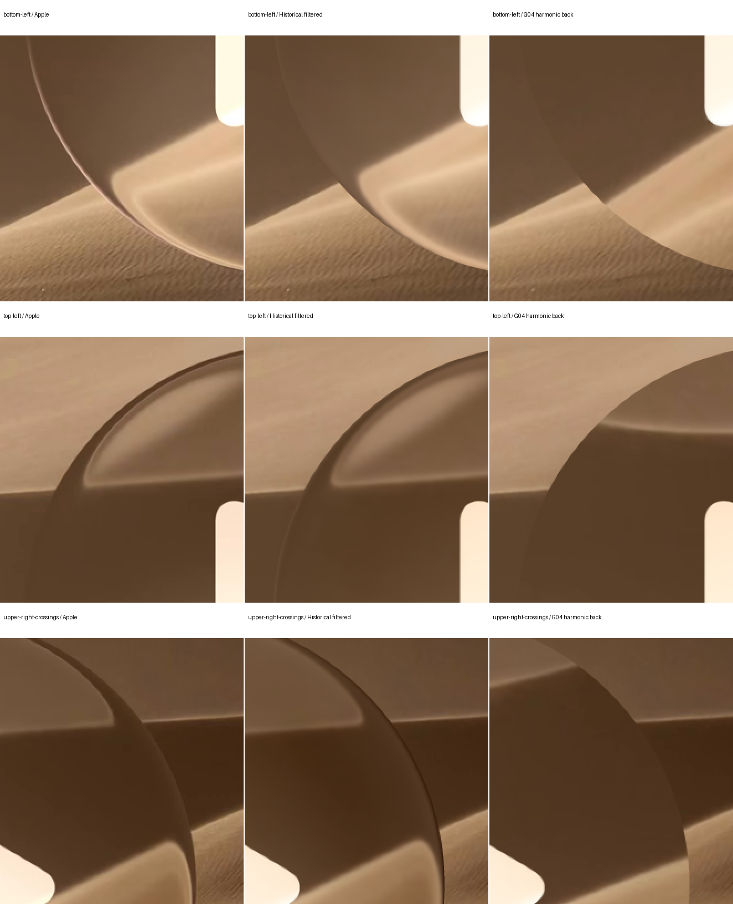
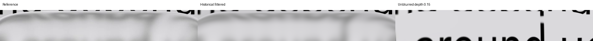
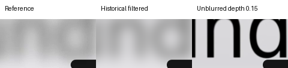
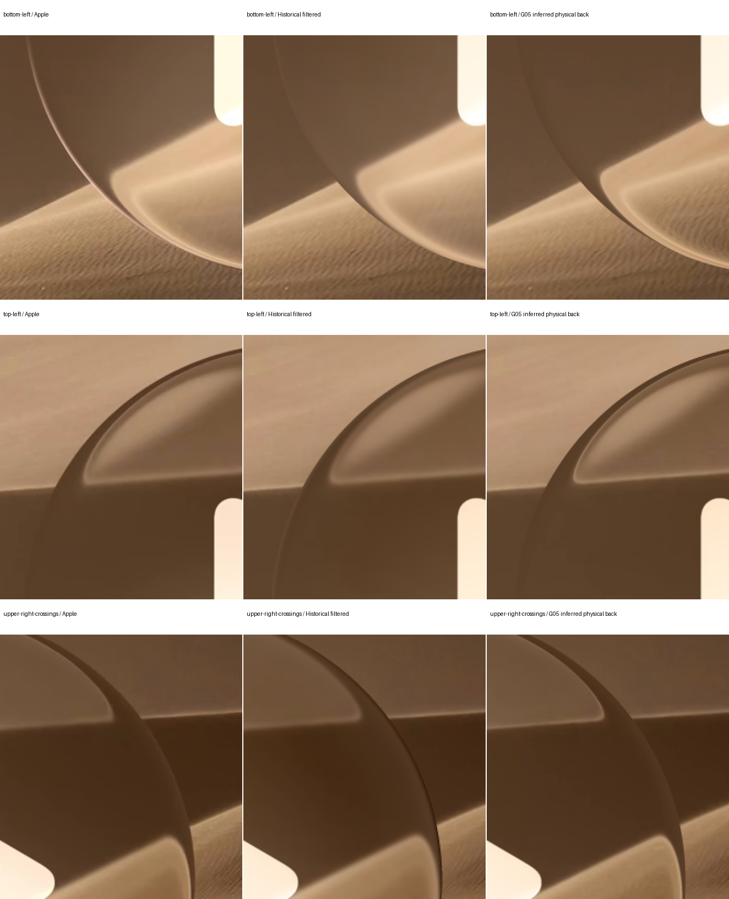
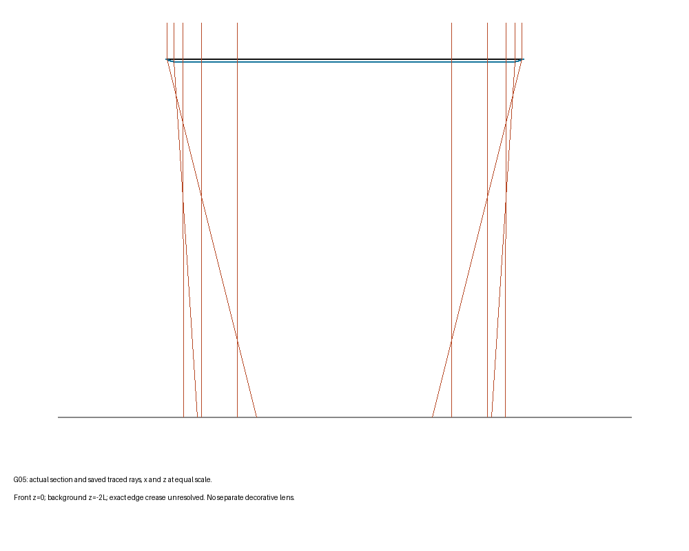
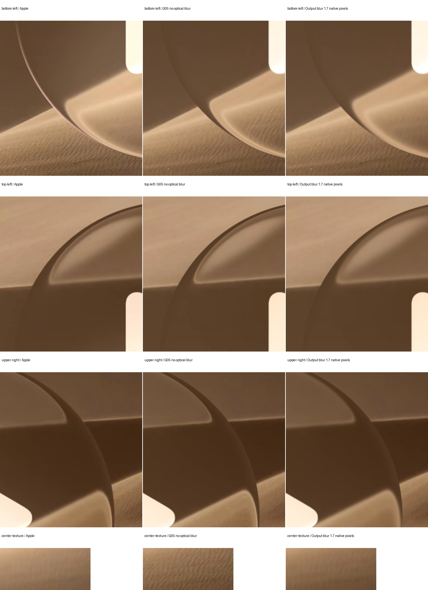
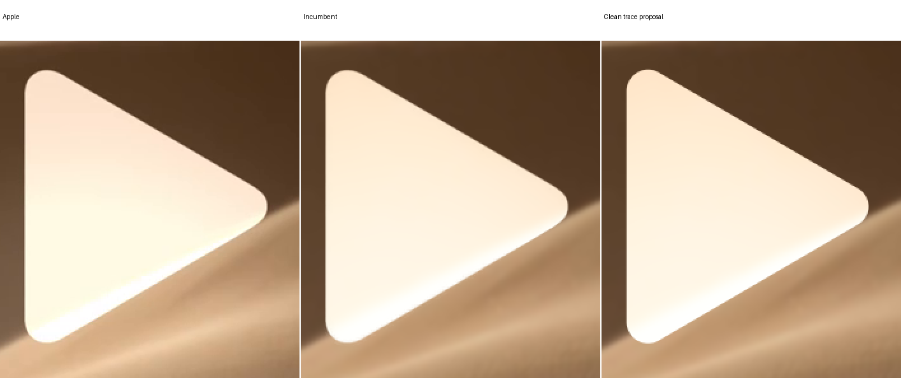

# Geometric optics

[Recreations](reconstruction.md) · [Historical reproduction recipes](recreation-models.md) · [Guide](README.md)

New refraction studies use explicit optical surfaces. Their intersections, normals, ray paths and section views describe the same geometry. Historical displacement maps and filtered image fits remain reproducible controls; they are not the new optical implementation.

## Scope and conventions

- Lengths use the minor half-extent `L`; x points right, y down, +z toward the camera. The first comparator uses an orthographic camera, front plane `z=0` and background plane `z=-D`.
- Geometry determines refraction. Parameters describe shape, thickness, camera, index or scene placement. No independent normal adjustment, fitted screen displacement or post-trace residual warp is allowed.
- Pixel integration and interpolation are numerical sampling. Optical scattering/blur, spectral dispersion, reflection, lighting, color, foregrounds and shadows are separate material/compositing stages. They cannot conceal a failed geometric comparison.
- The first tracer follows the primary transmitted branch. It does not implement finite-camera entry, arbitrary side intersections, reflected radiance or a complete dielectric energy solution. Those are separate claims requiring corresponding geometry/path tests.
- Source bytes, registration, masks, reference crops and accepted historical baselines stay fixed. A new source or sampling convention is declared separately, never counted as an optical improvement.

## Shared height surface

The initial closed solid has a flat front, a convex footprint and back `z=-h(x,y)`. Its height is concave and nonnegative. Over a circle, `rho=sqrt(x²+y²)`. Define:

```text
u = max((rho-core)/(1-core), 0)
h = edge + depth (1-u^p),  rho <= 1
```

`0<=core<1`, `depth>0`, `edge>=0`, `p>=3`. The plateau and bevel meet with continuous first and second derivatives. Height decreases toward the edge and its radial second derivative is nonpositive. A finite cut edge is part of this hypothesis; it does not establish Apple's surface shape.

The side closes the solid over the footprint boundary, between `z=-edge` and0. A ray exactly on a crease has no unique interface normal. The tracer reports that path unresolved, with NaN source coordinates, instead of choosing an image sample. Clear misses use their ordinary unobstructed ray.

For a continuous pill, the same height profile can use the convex coordinate `rho=sqrt(T)` from the [continuous footprint](recreation-models.md#continuous-pill-footprint-candidate). This coordinate is neither a homogeneous norm nor Euclidean distance. Its actual derivatives enter `grad h=h'(rho) grad rho`. A decreasing concave profile composed with this convex coordinate gives a concave height. Footprint shape and depth curvature remain meaningful geometric parameters; optical calculations are shared.

## Refraction and complete primary paths

Given unit incident direction `i` and unit normal `N` pointing toward the incident medium:

```text
eta = n_from / n_to
c = -dot(i,N)
k = 1-eta²(1-c²)
t = eta i + (eta c-sqrt(k)) N
```

For `k<0` there is total internal reflection; `k=0` is the critical grazing boundary. Neither supplies a transmitted pixel in this diagnostic. Snell refraction and Fresnel energy transport are distinct parts of a dielectric model. [PBRT's derivation and implementation](https://pbr-book.org/4ed/Reflection_Models/Specular_Reflection_and_Transmission) documents both, with a different incident-vector/index-ratio convention.

Orthographic entry through the flat front is normal incidence. The internal ray reaches `(x,y,-h)` directly. Back outward normal is `normalize(-h_x,-h_y,-1)`, derived from the actual height. The ray then intersects the background plane:

```text
travel = (D-h) / (-t_z)
background_hit = (x,y,-h) + travel t
```

For exterior index1 and interior index `n>1`, a global slope bound `M<1/sqrt(n²-1)` guarantees subcritical transmission. Require `D>max(h)` and a downward exit. Concavity certifies no back reentry: along the exiting ray, `g(s)=z(s)+h(x(s),y(s))` is concave and starts with a negative derivative. It stays below the back; upon leaving the footprint it is below the side. This proof applies to the restricted orthographic geometry, not arbitrary cameras or solids.

**Primary path completeness is not full radiance completeness.** The image renderer remains primary-only. Shared Fresnel components and ordered reflected-path steps now support bounded geometry/energy audits, but the current reflected-light audit is incomplete. Unknown background samples, unresolved boundaries and invalid branches must be reported, never hidden by clamping coordinates or dropping scored pixels.

## Outline transport audit

The same circular height can be wrapped as a closed solid with a flat front. Shared `next_convex_boundary` advances an inward boundary ray using the existing bounded bisection; intersections and normals still come from that solid. There is no origin nudge or alternate normal field. Dielectric s/p Fresnel powers and reflection directions are separate reusable primitives; they do not supply an environment image or replace a missing path.

For the current thin G05 lens, 997 cached primary paths plus12 unit-index controls conserved energy within2.23×10⁻¹⁶ and matched the flat-core parallel-slab analytic check. After the declared32 internal encounters, some paths still retain about4.19% incident power. The audit is therefore **incomplete**, with no reflected-light image or accepted outline correction. The source/geometry and historical controls remain fixed. [Audit scope, budgets and limitations](experiments/reconstruction/studies/geometric-playback/outline-path-audit.json)

The circular paths stay meridional, allowing separate s/p weights without rotating their axes; that simplification is not a general3D polarization model for pills. An assumed environment and source-transfer convention would be additional scene/material inputs. Neither unknown HDR light nor unresolved internal energy may be replaced with target-colored pixels. Mathematical direction/path correctness, material softness, visible outline agreement and device performance remain distinct claims.

## Verification and reproduction

[Shared profile, Snell and restricted tracer](experiments/reconstruction/geometric_optics.py) · [Geometry controls](experiments/reconstruction/test_geometric_optics.py)

```sh
cd docs/liquid-glass/experiments/reconstruction
python -m unittest test_geometric_optics.py
```

The controls cover height/gradient consistency, section identity, Snell reciprocity, unit-index identity, symmetry, clear misses, exact crease rejection, critical/TIR rejection, and the C2 concave profile. Declared floating-point tolerances test numerical implementation; they do not relax reference-image acceptance.

Each experiment declares the visible defect, physical parameters, frozen nuisance stages, references, wall/evaluation budgets, checkpoint and stop condition. Review after at most three substantive proposals, including rejects. Visible fidelity and local regressions lead acceptance; an imperceptible aggregate gain is insufficient. Mathematical correctness, visual fidelity, cross-control transfer and device speed remain separate assessments.

## Circular play control: first geometric comparison

Reference: [Apple's clear playback control,219 at3:10](https://developer.apple.com/videos/play/wwdc2025/219/?time=190), using the frozen registered photograph from3:00. Earlier notes questioned the abrupt shoulder and outer reversed strip. Ana later clarified that edge reversal belongs in this reference; the comparison must test its shape and extent rather than remove it. Exact local windows remain bottom-left[690,570,910,810], top-left[690,290,910,530], upper-right[1025,320,1245,560].

**Match reference-specific reversal.** Ana explicitly superseded her earlier no-reversal note for this particular lens: edge reversal is wanted. Compare its onset, location, strength, extent and transition with the reference. The initial no-fold aim is historical, not an active acceptance constraint. A mapping fold, or its absence, is not by itself success or failure.

**Useful negative result; no accepted fidelity improvement.** Three explicit bevel surfaces were evaluated, with4×4 native pixel integration and no optical source/output blur. The reversed strip is absent, but visible dune crossings under-refract and their curves remain inaccurate. These tests do not rule out a different convex back, a curved front or a finite camera.

| Surface | Core / depth / power | Edge displacement / L | Sampled minimum radial map derivative |
| --- | --- | ---: | ---: |
| Narrow bevel | .6 / .02 /3 | .15129 | .21924 |
| Broad bevel | .3 / .04 /3 | .17336 | 0.47862 |
| Geometrically limited depth | .6 / 0.02397512 /3 | .18204 | 0.05069 |

The third depth came from12 bounded geometry-only bisections with a sampled nonfold margin, without target pixels or image optimization. That historical constraint was too broad as a fidelity objective; its result is preserved as a diagnostic. Sampled derivatives are not interval proofs. The old empirical map folds from about radius.91327L outward. Reconstructing it preserves that pattern; whether a particular part is wrong requires localized reference comparison.



Columns: Apple; historical filtered fit; new geometric depth-limit diagnostic. Bottom-left/top-left/upper-right RGB errors change from8.083/8.448/7.193 to14.493/14.416/11.483. Color, missing lighting and optical-filter differences also affect these errors; they are not isolated geometric-error measures. None is counted as a successful reconstruction.

The new body uses only the frozen historical constant RGB gain/bias, without its spatial lighting field. Existing calculated icon color and coverage are frozen separately, including their historical icon-only filtering. This isolates lens work and does not establish a new unified icon material. The current most-polished historical image remains unchanged.



This section and these rays use the same height function and parameters as the rendered refraction. Exact rim-crease rays are unresolved; native4×4 circle samples have no exact crease hits. The shape certificate and all actual source queries were checked. No Fresnel radiance, finite-camera, spectral or device-speed claim is made.

## What the inverse geometry establishes

The historical folded radial map can itself come from a convex back and flat front. For inward displacement `a(r)`, back height `h(r)`, index `n` and background distance `D`, the transmitted branch satisfies:

```text
q = a / (D-h)
s = q / (n sqrt(1+q²)-1)
h' = -s, h(1)=0
```

At `n=1.5,D=2`, two ODE tolerances and two surface resolutions were checked. Nonnegative piecewise-linear curvature, integrated twice, defines a single C2 concave height; normals are its exact polynomial derivatives. With513 nodes, traced displacement differs from the diagnostic map by at most0.000902 native pixels. Its minimum Snell discriminant is0.4731, yet its minimum radial map derivative is−13.1014: **the reversal is transmitted refraction, without total internal reflection.**

This is a useful realizability result, not a reconstruction improvement. Converting the old map into valid geometry preserves its fold pattern; this alone neither fixes a mismatch nor makes the reversal undesirable. The test neither identifies Apple's surface nor rules out other flat-front shapes or camera distances. [Numerical convergence, budgets and limits](experiments/reconstruction/studies/geometric-playback/g02-realizability.json)

Reproduce without private photographs using [the geometry-only inverse check](experiments/reconstruction/geometric_inverse.py):

```sh
python geometric_inverse.py studies/playback/review-round/pass-03.json NEW_OUTPUT
```

## Closed curved-front discriminator

The second shared shape hypothesis is a closed oval. With circle `T=x²+y²`, minor-depth parameter `eta`, longitudinal half-size `a` and `u=(z+eta)/eta`:

```text
F = T + (1+kappa (x/a)²) u² - 1
solid: F<=0; 0<=kappa<=1/3
```

The same equation accepts the continuous pill's convex `T`. In the containing `|x/a|<=1` slab, the added term's x/u Hessian determinant is `4 kappa u² (1-3 kappa (x/a)²)/a²>=0`; the solid is convex. Entry uses its actual front root. A declared bounded bisection finds the ordered second intersection, and the gradient of this same `F` supplies both normals. Existing Snell calculations are reused. Exact projected tangencies, critical/TIR and non-downward exits remain unresolved, never substitute background pixels.

**Useful negative; no image or fidelity success.** At `eta=.15,n=1.5,D=2`, both fixed circle shapes fold and have unavailable primary transmission near the rim:

| κ | Interior sampled paths | TIR paths | Exact ellipsoid intersection error |
| --- | ---: | ---: | ---: |
| 0 | 3613 | 108 | 2.6×10⁻¹² L |
| 1/3 | 3613 | 104 | Not an ellipsoid |



No image was rendered because a primary-transmission-only model cannot fill those TIR paths. The transmitted regions also reverse, a descriptive observation requiring reference-specific comparison rather than automatic rejection. These two fixed shapes do not rule out all curved fronts, finite cameras or full reflected transport. [Exact parameters, path counts and solver tolerances](experiments/reconstruction/studies/geometric-playback/g03-closed-oval.json)

The [closed-surface check](experiments/reconstruction/geometric_closed_check.py) takes only a new output directory:

```sh
python geometric_closed_check.py NEW_OUTPUT
```

## A back surface with two curvatures

The shared harmonic construction combines two real concave heights, `H(a,b)=ab/(a+b)`. Its partial derivatives are nonnegative and sum to at most1; its Hessian is negative semidefinite. Therefore concave input heights produce a concave back, with gradient bounded by the larger input bound. This is geometry, evaluated before refraction, rather than a correction to sampled pixels.

The fixed circular test uses `a=.15(1-r³)`, `b=.4(1-r²)`. The elongated toolbar uses the same construction and depths, but `b=.4(1-(x/a_major)²)` supplies a longitudinal crown. This change reflects rotational versus elongated symmetry. Index1.5, background distance2L, flat-front tracing, source interpolation and raw unit transmission stay unchanged. The circle's global slope bound.8 and pill's.45 are subcritical.

**Visual transfer fails at these parameters.** The circle places the dune crossings incorrectly; its nonfolding paths are not themselves a benefit. The pill supplies nonzero central longitudinal curvature, but too little visible text stretching and cap behavior that remains to be matched locally. Both studies froze their sources/masks/registration, used no optical source/output blur and stopped after the declared fixed images. Missing illumination and the toolbar's estimated paper/unknown source PSF confound full RGB errors; none is called a reconstruction success.

<details><summary>Circle: fixed Apple / historical / harmonic-back crops</summary>



[Parameters and all local regressions](experiments/reconstruction/studies/geometric-playback/g04.json) · [Reproduction surface](experiments/reconstruction/studies/geometric-playback/g04-surface.json)

</details>

<details><summary>Toolbar: fixed upper and adjoining d-stroke crops</summary>





[Exact parameters, source confidence, geometry checks and all local measurements](experiments/reconstruction/studies/geometric-playback/toolbar-harmonic.json). Raw clear transmission is a diagnostic, not a completed frosted material. The historical filter remains a separate control; it was not retuned to hide geometric mismatch.

</details>

## A geometric starting point from the closer historical fit

G02's inferred surface is now rendered directly. Its513 curvature knots specify an actual C2 piecewise-cubic back, a flat front and an edge crease. Integrating curvature supplies the height and its analytic derivative; no empirical refraction map runs in this renderer. Global concavity, subcritical slope and background clearance certify complete primary paths. All7,126,400 native4×4 source queries and their four bilinear texels passed the frozen registered-frame domain check before source sampling. This certifies address support, not exact hidden scene RGB or registration/PSF truth.

**This is a closer geometric baseline, not an accepted visible improvement.** It preserves the historical fold and outer texture compression; their onset and extent must be judged against the corresponding reference regions. Its top-left and upper-right dune crossings are much closer than the broad surfaces, while the bottom-left highlight, boundary color and texture softness remain wrong. The old filtered/graded fit remains the historical visual reference. Source/output optical blur is0 in this new body; its icon alone retains the explicitly frozen historical calculated color/filter. Full RGB comparisons include the deliberately absent body grading and illumination.



| Fixed crop | Historical filtered RGB RMSE | Unblurred geometric baseline |
| --- | ---: | ---: |
| Bottom-left | 8.083 | 13.305 |
| Top-left | 8.448 | 8.327 |
| Upper-right crossings | 7.193 | 7.392 |

One local metric improves while other defects remain. That is not grounds to accept the lens as fixed. The geometric baseline's sampled radial map matches G02's physical surface exactly; a32-pixel public-wrapper control also matches its saved image exactly, without repeating a full render.



[Surface and path evidence, all local errors and limits](experiments/reconstruction/studies/geometric-playback/g05.json) · [Exact surface definition](experiments/reconstruction/studies/geometric-playback/g05-surface.json)

```sh
python geometric_playback.py INPUTS \
  studies/playback/review-round/pass-03.json HISTORICAL_M.npy \
  studies/geometric-playback/g05-surface.json NEW_OUTPUT
```

The [shared core](experiments/reconstruction/geometric_optics.py) also supplies harmonic heights and curvature-defined backs. The [crowned bevel](experiments/reconstruction/crowned_bevel.py), [closed crown](experiments/reconstruction/closed_crowned_surface.py) and [harmonic crown](experiments/reconstruction/harmonic_crowned_back.py) adapters define actual surfaces and derivatives, without private refraction/shader implementations. Shared circle fixtures and independent source/path checks establish implementation compatibility. They do **not** establish visual transfer, Apple's geometry, full dielectric radiance or Android performance.

The common [image-formation function](experiments/reconstruction/geometric_render.py) handles physical projection, tracing, source sampling and pixel integration for both circles and pills. Its default remains4×4; an explicit `samples_per_axis=2` preserves an element’s existing2×2 protocol, without claiming a quadrature change as optical progress. Optional source-known and required-pixel masks reject unsupported lens/guard rays before RGB lookup; only explicitly unscored clear exterior may return NaN with a false support mask. No coordinates are clamped or source holes filled. Registered-source provenance still needs its scene-specific audit. Optional `return_layers=True` exposes the SAME integrated lens color, physical coverage and premultiplied clear contribution, so later material stages do not trace a second map. The shared `coverage_blur` material operation filters premultiplied lens color and divides by filtered coverage, preserving sharp shape alpha and the clear backdrop. Its explicit finite radius is `ceil(3 sigma)`; sigma scales with L and must be audited separately from AA and source interpolation. It is an ordinary Gaussian material approximation, not a geometric warp, dispersion or a full rough-surface transport claim. A shared achromatic `neutral_color_response` supplies common gain/bias and an optional source-luminance highlight lift before that filter. Gain `t` and bias `1-t` give a neutral white veil; these are declared encoded-RGB material controls, not independently fitted RGB channels or measured radiance. Three32-pixel controls match the saved inferred-circle, harmonic-circle and harmonic-toolbar outputs after an explicit common float32 cast; the toolbar's original float64 difference is at most2.79×10⁻⁸. These are software checks, not new score improvements. [Exact control scope and precision](experiments/reconstruction/studies/geometric-playback/shared-render-control.json)

Clear and frosted appearance are not forced to share blur parameters. The geometric baselines above are unfiltered; the isolated material checklist below tests ordinary color filtering separately. This material approximation is not a measured rough-surface model. The foreground grader is a labeled historical control, not a new shared physical material. The held-out Music Navigation comparison also remains incomplete: its source/path preflight was started, but the original budget ended before all guard/compositing checks and an image. There is no claimed third-reference visual validation.

## Isolated material checklist

The timed checklist retains the G05 geometry: the bounded refraction proposals did not improve all protected regions. Their failure does not reject the desired edge reversal. A fourth geometric checkpoint exceeded its declared ray budget and stopped before any image; it is not an accepted model result.

**Accepted local increment:** a coverage-normalized output color Gaussian of sigma1.7 native pixels, or1.7/245L, improves the sand texture while leaving shape alpha, source, geometry and foreground fixed. The finite kernel radius is6 native pixels; this is an explicit color-softness stage, separate from4×4 antialiasing. Its lens-versus-capture/PSF origin is not identified. Texture-band RMS changes from3.726 to1.122 versus Apple's1.147. A score-minimizing2.5px alternative was rejected for visible over-softening.



| Measurement | Unfiltered G05 | Accepted softness |
| --- | ---: | ---: |
| Glass RGB RMSE | 13.081 | 12.569 |
| Rim RGB RMSE | 14.651 | 13.872 |
| Interior RGB RMSE | 11.318 | 11.134 |
| SSIM | .93295 | .96980 |
| Full foreground MSE | 98.656 | 98.167 |
| Exterior MSE | 24.090 | 24.067 |

The auxiliary outer-rim MAE regresses16.528→16.897 despite improved RMSE. Missing thin highlights, lower-left illumination and crossing offsets remain. The more polished historical fit is unchanged. The original G05 image above remains the unfiltered control.

Common neutral grading proposals improve some dune tones but fail perimeter/exterior protection. The reflected-path outline audit is incomplete, so no outline image is accepted. The best generated-shadow change is too small and uncertain to count as visible progress. Dispersion is absent for this play button and was skipped.



The original SF play path and one clean symmetric triangle with circular corner arcs were tested separately from icon color. Both fail the fixed full-foreground check: MSE130.632 and120.473 versus98.167. Current-background icon-response controls also regress. The old raster coverage and empirical-material-driven icon grader therefore remain a **labeled historical dependency**, not a completed solid-vector or unified physical foreground model. No target-colored outline or screenshot matte was substituted.

An audit corrected the root's supplemental foreground checker: it had reversed the x/y arrays returned by points(). Its old foreground values and initial icon-acceptance flags are superseded; original body scores and exterior checks were unaffected. Correct saved-array checks preserve the blur acceptance and reject both icon proposals. [Measurements, bounded experiments and remaining limits](experiments/reconstruction/studies/geometric-playback/pipeline-01.json)

The same coverage filter and neutral encoded-color function were independently replayed on two expanded-miniplayer backgrounds. Clear and frosted materials use distinct, declared softness values; the optical surfaces and shared ray calculations remain independent of that stage. This establishes reusable software and paired material increments within those diagnostic pipelines, **not transferred optical fidelity** or a completed held-out third reference. Review stops at the checklist boundary; no motion or device-performance result is implied.

## What distance can and cannot identify

Changing background distance with the G05 surface fixed changes refraction: edge displacement is.317L at D1, .634L at D2 and1.269L at D4. But different real back surfaces can compensate that distance change. Two additional bounded inverse checks, reusing the D2 evidence, found:

| Background D/L | Actual maximum height/L | Maximum back slope | Maximum map discrepancy, native pixels |
| --- | ---: | ---: | ---: |
| 1 | .032682 | .817138 | .000843 |
| 2 | .018579 | .552974 | .000902 |
| 4 | .009668 | .305756 | .000924 |

All three are concave, subcritical, complete primary-path geometries matching the same diagnostic map to the declared numerical tolerance. **One map cannot uniquely determine both surface and background distance.** This does not show that distance has no effect, identify Apple's camera or establish image accuracy. The study used85,927 fresh geometry rays,1,274 ODE evaluations and zero images/fits; it stopped within its five-minute budget. [Complete convergence and fixed-surface results](experiments/reconstruction/studies/geometric-playback/g06-distance.json)

```sh
python geometric_inverse.py studies/playback/review-round/pass-03.json \
  NEW_OUTPUT --distance 1 --seconds 120
```

The cached upper-horizon check also cautions against blindly fitting distance. Across61 fixed columns, strongest-gradient median displacement is.24–.51px depending on analysis scale, but all-column RMS is3.78–11.55px, with competing/boundary peaks retained. This is an uncertain edge detector, not a reliable optical correspondence or a reason to discard outliers. No distance image sweep was launched from it. [All columns, ambiguity flags and measurement limits](experiments/reconstruction/studies/geometric-playback/g05-landmarks.json)

[Exact parameters, local measurements and limits](experiments/reconstruction/studies/geometric-playback/g01.json) · [Geometry invariants](experiments/reconstruction/studies/geometric-playback/g01-invariants.json) · [Partial public-wrapper identity control](experiments/reconstruction/studies/geometric-playback/g01-portable-control.json)

Reproduce one diagnostic from the same frozen private inputs and historical cached material:

```sh
cd docs/liquid-glass/experiments/reconstruction
python geometric_playback.py INPUTS \
  studies/playback/review-round/pass-03.json HISTORICAL_M.npy \
  studies/geometric-playback/nonfold-depth-limit.json NEW_OUTPUT
```

The public wrapper reproduced an8160-pixel strip of a saved candidate exactly, without a second full-control render. All3 original candidates and their failed visual comparisons remain recorded. The bounded image study used3 renders,16 small geometry evaluations,0 image fits, and6min18s of its20-minute budget; subsequent code/packaging checks introduced no candidate search.
