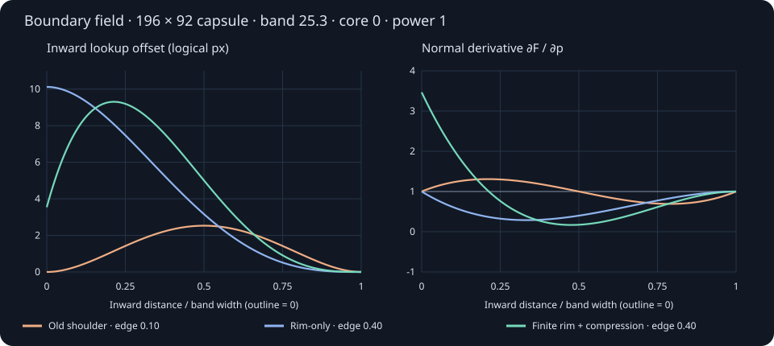

# Portable optical and motion equations

[Guide](README.md) · [Observed Apple evidence](optics.md) · [Lab](lab.html) · [Executable reference](model.js)

**Status:** mathematically specified Localica hypotheses, not recovered Apple formulas. These equations define a candidate for future rendering, not the current Android renderer. The small reference has no browser, GPU or framework dependency. The [portable fixtures](experiments/model-fixtures.json) provide boundary, core and corner coordinates/normals/derivatives for later backend comparisons. Use the same units and conventions when porting it; do not copy a shader's constants without its domains.

## Coordinates and validity

- Shape-local position `p=(x,y)`, positive X right, positive Y down; positive Z toward the viewer. All lengths use one logical coordinate system. Convert device pixels only at rasterization/sampling boundaries.
- Rounded rectangle half-size `h=(hx,hy)>0`; `0<r≤min(h)`. Circle and capsule are special cases. Zero radius is outside this model's domain.
- Rays propagate **toward** the interface. This differs from conventions that store a vector pointing back toward the ray origin.
- `F(p)` is an **inverse image map**: output position `p` samples source position `F(p)`. Source-feature movement has the opposite interpretation. Add the surface's backdrop-space origin after evaluating this local map.
- Material/optical state, source transform, clip, foreground and shadow must use the same frame and geometry. Optical mapping does not include foreground text.
- Valid finite input is a caller precondition. The reference is an oracle, not an untrusted-input API. Production adapters must reject invalid dimensions, nonfinite values and unsupported optical ranges.

For component-wise absolute value and maximum:

```text
q = abs(p) − h + r
sd(p) = length(max(q,0)) + min(max(qx,qy),0) − r
d = −sd(p)                         // positive inside
b = min(r, min(h) × band)          // 0 < band ≤ 1
u = clamp(d/b, 0, 1)
n = gradient(sd)                  // unit outward normal where differentiable
S(u) = 6u⁵ − 15u⁴ + 10u³
```

Inside the active band, straight sides have constant `n`; circular corner contours have curvature `κd=1/(r−d)`. **Straight segments have zero curvature even when one component of `max(q,0)` is positive.** The medial axis has no unique normal; the edge contribution and its first derivative vanish before or at that axis. The signed-distance outline is C1 at straight/arc joins, not globally C2. One-sided derivatives are appropriate there.

## Boundary field: displacement is not compression

This is a designed image warp, not an optical solid. It allows separate core magnification, edge strength, band width and outline displacement.

```text
R(u) = (1−u)³(1+3u)
H(u) = (256/27) u(1−u)³
P(u) = ρ R(u) + (1−ρ) H(u)        // 0 ≤ ρ ≤ 1
c = core × power
a(d) = b × edge × power × P(u)
F(p) = (1 − c S(u)) p − a(d) n
```

- `P(0)=ρ`, so a positive `ρ`, edge and power retain displacement at the outline. `P′(0)=(1−ρ)256/27`, so the map also has a rising compression band when `ρ<1`.
- `P(1)=P′(1)=P″(1)=0`: no artificial inner shoulder join. `0≤P≤1`; the maximum edge contribution is bounded by `b×edge×power`.
- In the core, `F=(1−c)p`; displayed magnification is `1/(1−c)`, provided `c<1`. The slider named optical power is dimensionless gain, **not geometric thickness**.
- The older `16u²(1−u)²` profile forces displacement and its derivative to zero at the outline. It explains an apparently inactive outer strip. The alternative `R` retains outline displacement but has a negative inward derivative: much of that band magnifies rather than compresses. Both remain explicitly labeled comparisons.
- None of these outline continuations is calibrated to Apple's outermost rim. A physical interface can have a source-coordinate discontinuity at its silhouette; that is different from an unwanted seam inside the material.



### Jacobian and folds

Let `t=(-ny,nx)`, `S_d′=30u²(1−u)²/b` within the band, and `a_d′=edge×power×P′(u)`. On a differentiable boundary segment:

```text
J = ∂F/∂p = (1−cS)I + c S_d′ p⊗n + a_d′ n⊗n − a κd t⊗t
Jnn = 1−cS + c S_d′(p·n) + a_d′
Jtt = 1−cS − a κd
Jtn = c S_d′(p·t); Jnt = 0
 det(J) = Jnn × Jtt
```

- A straight-edge normal derivative above 1 compresses source detail in the output; between 0 and 1 magnifies it. A large constant lookup offset is translation, not compression.
- Singular values of `J` describe general local directional scale; their reciprocals describe displayed feature scale. Determinant alone cannot establish isotropic compression. Zero determinant is a local collapse; a sign reversal indicates a fold.
- For nonnegative core, edge and power, the following **sufficient local nonfolding bounds** follow from `p·n≥0` and `b/(r−bu)≤1/(1−u)`:

```text
power × (core + edge × D) < 1
power × (core + edge × T) < 1
```

| Profile | Upper bound D on −P′ | Upper bound T on P/(1−u) |
| --- | ---: | ---: |
| Old shoulder | `16√3/9` | `64/27` |
| Rim-only R | `16/9` | `256/243` |
| Finite rim + compression | `ρ16/9+(1−ρ)64/27` | `ρ256/243+(1−ρ)1024/729` |

These are conservative: failing a bound means **uncertified**, not necessarily folded. They certify local orientation, not global one-to-one mapping. Motion changes effective power, so repeat the bound with its maximum depth multiplier. Extreme controls intentionally permit folds for inspection; do not silently ship those ranges as safe defaults.

## Refracting cap comparator

A second model relates a surface normal, thickness and backdrop distance through geometric optics. Its assumed solid has a rounded top and a flat exit plane; the camera is orthographic. Apple does not document this geometry. Generic transmission and reflection are distinct parts of the [Snell/Fresnel model](https://www.pbr-book.org/4ed/Reflection_Models/Specular_Reflection_and_Transmission).

### Height and analytic normal

```text
v = 1−u; f² = 1−v³; f = sqrt(f²)
C(p) = 1 − 0.036[(x/hx)² + (y/hy)²]
hcap(p) = H f C(p)
grad(C) = (−0.072x/hx², −0.072y/hy²)
N = normalize( H[1.5v² C n/b − f² grad(C)], f )
```

- The last expression is `(-grad(hcap),1)` multiplied by `f`. It evaluates the **vertical limiting rim normal** without a finite-difference stencil or division by zero. For `H>0`, `Nz→0` as `d→0+`.
- At `u=1`, `f` joins the weak curved crown with zero first and second shoulder derivatives. The crown coefficient is an adjustable-model choice fixed here at 0.036; it is not an Apple measurement.
- The former quintic-height ramp made the normal vertical in Z at the outline, flattening the rim and suppressing its refraction. Increasing height alone could not correct that boundary condition.
- `H` is geometric height; `G≥0` is the separate distance from the exit plane to the backdrop. The lab uses `H=L×thickness×power×dynamicDepth`, `G=L×gap`, with `L` the shorter **unstrained** half-size. No fixed 14/5-pixel geometry remains.

### Two-interface ray

For unit incident propagation vector `I`, unit normal `N` opposing it, and index ratio `η=nIncident/nTransmitted`:

```text
c = −dot(I,N)
k = 1 − η²(1−c²)
k < 0: no transmitted ray (total internal reflection)
T = ηI + (ηc − sqrt(k))N
```

For this comparator:

```text
I = (0,0,−1)
Tinside = refract(I, N, 1/ior)
Q = p + Tinside.xy × hcap(p)/(−Tinside.z)
Tout = refract(Tinside, (0,0,1), ior)
F(p) = Q + Tout.xy × G/(−Tout.z)
```

- Restrict `1≤ior≤1.4<√2` here. With orthographic incident rays, the first transmitted ray has `−Tinside.z≥1/ior`; at exit `−Tout.z≥sqrt(2−ior²)>0`. This avoids TIR and grazing denominators in this specific construction. It is **not** a general guarantee for tilted cameras or other shapes.
- Never replace a failed refraction with a zero vector or clamp a ray denominator to an arbitrary positive constant: both silently change the model. A more general renderer must handle reflection/visibility explicitly.
- The reference rejects exits outside the projected body. Tests sample ray segments beneath the top surface; they do not prove global solid-path validity for every future shape/parameter. Treat unvalidated geometries as unsupported.
- At the outline, thickness is zero but a nonzero gap can still yield a finite limiting offset. With `G=0`, outline displacement vanishes for a legitimate geometric reason. A physically correct grazing interface also reflects strongly; finite lookup displacement alone does not imply visible transmitted detail there.
- `H=0` or `ior=1` explicitly gives the identity map. The `H→0` limit is not uniform at an exactly vertical rim when `G>0`; this comparator is unsuitable as a fade-to-zero-opacity formula. Fade material coverage independently.
- Full Fresnel-weighted energy, internal reflections, absorption, dispersion, caustics and multiple scattering are absent. The lab adds an independent synthetic highlight (the field model uses a fixed 0.3-reference-height cap for that lighting only), so calling its complete output a physically accurate renderer would be incorrect.

## Sampling, coverage and color

- Optical coordinates extend to the boundary. Apply antialiasing to final **coverage**, not by multiplying displacement by a several-pixel edge ramp. The lab uses a one-framebuffer-pixel coverage band; filtering can still soften the first visible pixel.
- Capture enough backdrop beyond the body: a conservative field padding is `b×edge×power + core×power×max|p| + blurFootprint`. Cap padding must cover its validated ray offsets. Clamping to the capture boundary can mimic an inactive edge; repeating the last texel is not extra optical information.
- Scale all geometric lengths, backdrop coordinates and source padding together. Coverage width depends on raster density. The optical band has no fixed two-pixel floor. Shadows/highlight widths are separate artistic lengths, not optical invariants.
- The lab interpolates and blurs **encoded sRGB channels**, then tints, illuminates and applies its tone curve. This is an intentional image-space approximation, not radiometric scattering. A physical-light implementation must decode, filter in linear light and re-encode, including alpha/compositing conventions. [W3C's conversion definitions](https://www.w3.org/TR/css-color-4/#color-conversion-code) distinguish those spaces.
- Nine blur taps have nonnegative weights summing to one: center 1/4, four axial taps 1/8 each, four diagonals 1/16 each. Radius is an offset, not Gaussian sigma. At large compression, production sampling needs source-footprint filtering; nine taps do not guarantee alias-free reconstruction.

For an encoded channel `x∈[0,1]`, trim `τ∈[0,0.5]` and exponent `γ∈[1,2]`:

```text
light foreground: f(x) = x − τx^γ
 dark foreground: g(x) = 1−f(1−x) = x + τ(1−x)^γ
f′(x) = 1−τγx^(γ−1) ≥ 0
```

Endpoints are `[0,1−τ]` and `[τ,1]`; darker inputs cannot wrap above brighter ones. This is a channel bound, not a physical-luminance curve or a guarantee of a WCAG contrast ratio. Applying it after synthetic illumination preserves the chosen material endpoint. Foreground ink is outside the operation.

## Pressure and dynamics

Normal finger contact and a side-wall reaction act along different axes. Strictly, pressure is scalar; the boundary traction (force per area) has direction, and a stress tensor describes the general internal state. The lab models prescribed deformation, not a stress solution. A homogeneous, approximately incompressible deformation has principal stretches with product one; it does not require one specific redistribution law.

```text
sx = exp(q − z/2)
sy = exp(−q − z/2 − f p)
sz = exp(z + f p)
sx sy sz = 1
```

`q` is in-plane strain including the wall contribution, `z` is normal strain (negative while held), `p` is positive wall-compression magnitude, and `f∈[0,1]` apportions wall compensation into depth. During recovery `p` is a signed spring state. At fixed `z`, increasing `p` increases depth when `f>0`; simultaneous normal pressure can still leave total depth below rest. This answers the pressure-direction question without assuming Apple uses a volume law.

- This determinant-one construction conserves an affine volume **only if the entire original body is transformed**. Rebuilding corner radius and the height function is not that transformation. The lab's scale product is a proxy, not exact integrated volume.
- For exact conservation of a reconstructed cap, compute `V=H∫D fC dA` and choose `H=Vtarget/∫D fC dA`. The lab does not enforce that integral. An exact-volume model must also resolve constraints when maximum depth is reached.
- Pin the contacting edge by setting center to `wallPosition ± deformedHalfWidth`; do not compress about the old center. Changing footprint, optical band and depth must use the same strain state.
- Held normal pressure uses a critically damped approach; release retains velocity and uses configurable damping. Critical damping prevents oscillatory eigenmodes, not every overshoot from arbitrary initial velocity. A strict monotonic-contact rule requires a separate velocity/force constraint; abruptly clamping velocity sacrifices derivative continuity. This remains an interaction design tradeoff, not an automatic property of the spring. A retargeted spring does not reset its velocity. Constant area, constant perimeter and constant volume are different constraints; none is interchangeable.

For each spring coordinate with mass `m>0`, stiffness `k>0`, damping `c≥0`, constant target `x*` over a step, let `y=x−x*`, `a=c/(2m)` and `w0²=k/m`:

```text
y″ + 2a y′ + w0² y = 0
underdamped: w=sqrt(w0²−a²)
y(t)=exp(−at)[ y(0) cos(wt) + (v(0)+a y(0)) sin(wt)/w ]
critical: y(t)=exp(−at)[ y(0) + (v(0)+a y(0))t ]
overdamped: y(t)=A exp(r1 t)+B exp(r2 t)
r1,2=−a±sqrt(a²−w0²); A=(v(0)−r2 y(0))/(r1−r2); B=y(0)−A
```

The reference returns both position and the derivative of these expressions. Fixed-target energy `½mv²+½ky²` cannot grow. Exact steps compose independently of frame partition; changing targets/forces and contact constraints still require event-time sampling. The lab retains bounded substeps for those inputs, with analytic spring updates. Its braking impulse, strain clamps and frame-delta cap are interaction approximations, not a solved fluid/stress system. Test pauses, interruptions and boundary ownership separately.

## Verification and remaining gates

Run `node experiments/equations-test.cjs` without browser dependencies, then the browser suites in [Run and verify](optics.md#run-and-verify). Seeded tests cover limits, independently differenced Jacobians, both ray interfaces, pressure and exact spring evolution. Random coverage is evidence, not proof of untested domains. The browser oracle compares actual pixel centers against this reference, including the first fully covered edge pixel; GPU/software agreement alone could reproduce the same bug.

Required before native adoption:

1. Freeze supported parameter domains; reject or clearly distinguish folding/unsupported cases. Retain a shared source-coordinate and color-space contract across backends.
2. Port reference fixtures, scale/mirror tests, endpoint and interruption cases to both native adapters. Measure device frame times separately from functional correctness.
3. Calibrate on exposed-source Apple scenes with known state/settings, then hold out independent scenes. The [HD reconstruction study](reconstruction.md) now measures three conditional still-image fits, with explicit source/foreground exclusions. Independent-scene and temporal validation remain open.
4. Keep the measured evidence, artistic choices and mathematical guarantees separate. Neither the finite-rim profile nor the cap has established Apple rendering parity.
