# Apple reference reconstructions

Native-HD Apple references compared with numerical reconstructions. **Apple is on the left; our rendering is on the right.** Three scenes test optical detail; two additional scenes test light/dark material treatment.

[Playback](#clear-playback-control) · [Toolbar](#archive-and-plus-toolbar) · [Slider](#active-slider) · [Light/dark](#light-and-dark-surfaces) · [Material roles](#when-to-use-each-material) · [Measurements](#measurements) · [Method](#method) · [Reproduce](#reproduce) · [Guide](README.md)

The glass on the right is computed from an uncovered-background reconstruction. Reference symbols are held identical on both sides. The exterior is retained beyond a 10-pixel contact band, where recovered background and an estimated exterior-shadow residual replace the original rim. **Foreground and exterior pixels do not contribute to the scores.** These offline fits use an experimental material; they are not captures of the current lab or Android renderer.

## Clear playback control

Apple, [Meet Liquid Glass, 3:10](https://developer.apple.com/videos/play/wwdc2025/219/?time=190). The circle is approximately 490 pixels across; its uncovered photograph appears at 3:00.


- The sand texture stays visible. Extra Gaussian blur is limited to **0–0.5 native pixel σ**, independently of optical strength. Bilinear texture sampling still filters subpixel coordinates.
- The strong rim and comparatively quiet center need separate parameters. Increasing central magnification cannot substitute for the sharply bent dune boundaries.
- The smooth-crown comparator varies central flatness and meridional curvature independently. Its height and analytic normal have no distance-band shoulder join. A plain ellipsoidal trial fitted worse; the flatter-center family is retained as a hypothesis, not evidence of a literal flat-topped Apple solid.
- Residual differences remain at the ridge/rim intersections and in texture registration. The reference photograph's exposed features register well, but that does not establish exact grain correspondence behind the lens.

<details>
<summary>Full-resolution screenshots, side by side</summary>

[](assets/match-media-full.png)

Each half retains 1920 × 1080 pixels. Distant exterior and the foreground symbol are shared; the contact band is estimated.

</details>

<details>
<summary>Starting optics, recovered background and error map</summary>

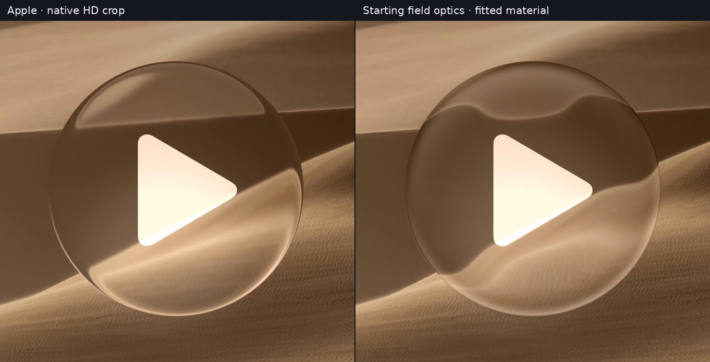

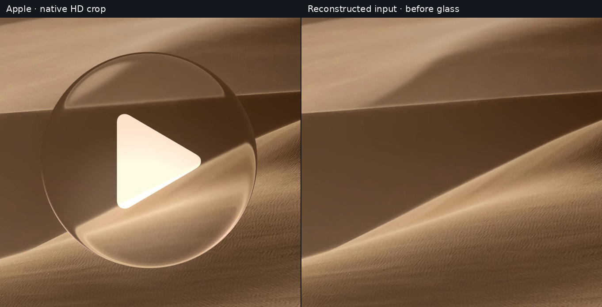

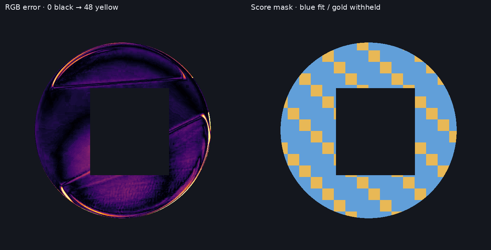

Error: mean absolute RGB difference, fixed 0–48/255 scale, dark to bright. Mask: blue training region, gold withheld blocks; dark regions are excluded. Fitting uses a deterministic subset of the blue pixels.

</details>

## Archive and plus toolbar

Apple, [Meet Liquid Glass, 11:50](https://developer.apple.com/videos/play/wwdc2025/219/?time=710). The outline is approximately 784 × 340 pixels. Text exposed at 12:00 supplies the background.


- The test uses the **same archive and plus symbols**, including their native outlines and antialiasing. Substituting similar icons obscured material differences in the previous comparison.
- A sharp rim and a softer interior are fitted separately. Uniform blur concealed compressed, inverted text at the boundary. The source-blur blend now approaches zero at the silhouette and rises smoothly inward.
- Matching that inverted detail remains an explicit criterion. A low overall RGB error can favor a washed-out surface that fails this part of the reference; the enlarged rim comparison below exposes it.
- The scalar normal-only map could not widen text along straight horizontal edges. The [tensor comparator](model.md#tangential-curvature-and-smooth-crowns) adds tangential scale tied to distance and local outline direction. It preserves central registration while allowing wider features near top/bottom and curved ends.
- A uniform-background control reproduces the old lower inner highlight without any refraction: its independently fitted Gaussian lighting terms contribute to that band. It must not be diagnosed solely as an optical displacement error. The refined fit and error map still expose remaining lighting/geometry mismatch.
- Background recovery uses a smooth page-color field rather than a constant-gray rectangular replacement. Where the later source's own glass hides the page, a blank field is assumed; missing text cannot be recovered there.


<details>
<summary>Full-resolution screenshots, side by side</summary>

[](assets/match-regular-full.png)

The distant exterior shadow is shared reference context; the contact-band estimate is not a validated shadow reconstruction.

</details>

<details>
<summary>Starting optics, background and error map</summary>

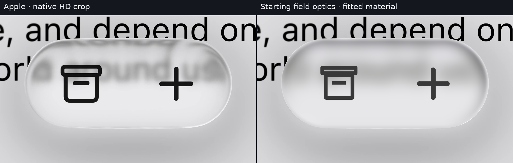

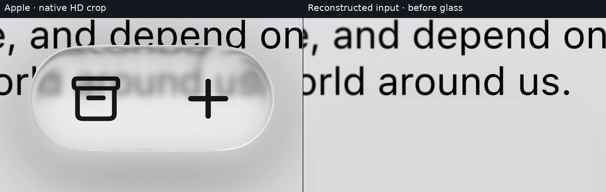

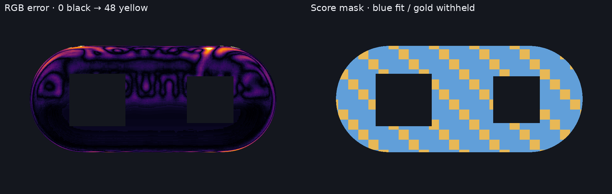

</details>

## Active slider

Apple, [Build a UIKit app with the new design, 18:12](https://developer.apple.com/videos/play/wwdc2025/284/?time=1092). The expanded thumb is approximately 237 × 113 native pixels.


- **No Gaussian blur is applied.** The blue/gray track remains sharp; curvature changes its apparent width near the boundary.
- The earlier `n=2.5` superellipse misplaced part of the upper rim outside the glass mask. A [smooth polynomial-oval fit](model.md#reconstruction-comparators) now follows the measured contour: 54 native columns fit, 27 withheld. Upper-ridge RMS is **0.109 pixel fitted / 0.105 withheld**, versus 1.282 pixels for the old assumption. The dark ridge is a boundary proxy; bottom/right symmetry and footprint extents remain assumptions.
- The page field comes from the resting-control frame at 18:10.5, before this transparent lens appears. Track colors/thickness come from uncovered portions; the hidden blue endpoint remains an estimate.
- Curvature is tested separately from the outline: smooth rounded crowns, normal-derived Fresnel/environment lighting, wavelength-separated lookups, and an RGB reflected-environment alternative. No colored upper-left outline is painted into the reconstruction.
- The upper rim contains a small green/yellow shift. [Color diagnostics and fit records](experiments/reconstruction/refinement.json) distinguish it from the reconstructed blue/gray/page field. **This is evidence of a colored effect, not proof of dispersion.** The recorded video is `yuv420p`; chroma subsampling, unknown lighting and adaptive processing limit attribution.
- The surrounding contact glow is retained reference context and is not counted as reconstructed background or scored glass. Thin rim and directional-light differences remain visible.

<details>
<summary>Full-resolution screenshots, side by side</summary>

[](assets/match-slider-full.png)

Each half retains native 1920 × 1080 pixels; the small thumb has not gained detail through enlargement.

</details>

<details>
<summary>Starting optics, uncovered page/track and error map</summary>

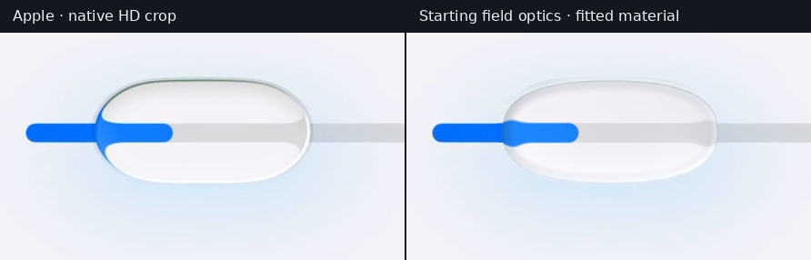

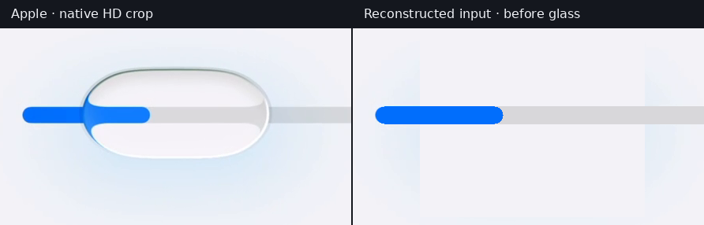

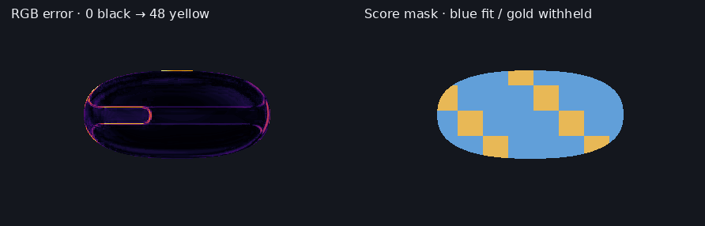

</details>

## Light and dark surfaces

Apple's [legibility demonstration, 15:15–15:20](https://developer.apple.com/videos/play/wwdc2025/219/?time=915) shows the same-sized surface adapting to light and dark surroundings. These additional references test brightness, broad lighting and the rim—not optical displacement, because their backdrops contain little or no detail.


The optical profile is fixed to the starting field rather than being inferred from these nearly uniform inputs. The identity baseline is included in the results: a high similarity score here cannot validate refraction.

<details>
<summary>Light surface: full resolution, input and error</summary>

[](assets/match-regular-light-full.png)

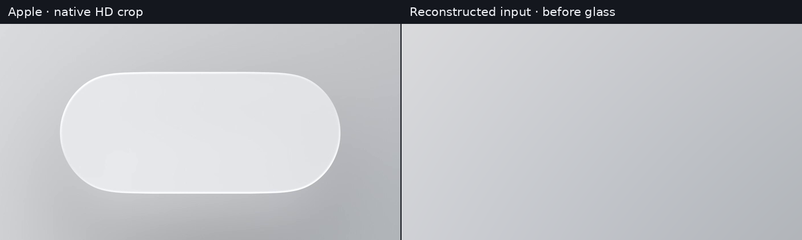


</details>

<details>
<summary>Dark surface: full resolution, input and error</summary>

[](assets/match-regular-dark-full.png)

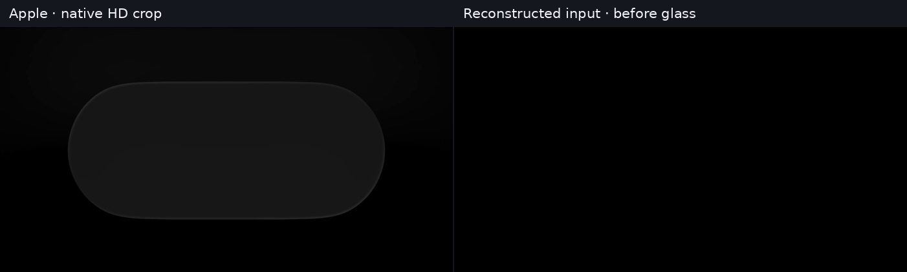

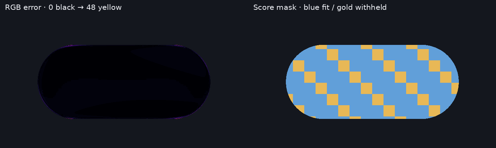

</details>

## When to use each material

The [specification's material-role rule](specification.md#material-selection) owns the implementation decision. This comparison supplies evidence and exceptions:

| Context | Apple guidance / observation | Consequence for calibration |
| --- | --- | --- |
| Media playback over photos/video | Clear preserves media detail; bright, prominent foreground content and compatible dimming support legibility. | Start with negligible added blur. Fit curvature without washing away texture. |
| Navigation, toolbars and text-bearing surfaces | Regular adapts blur and brightness for legibility. | Fit optical detail separately from scattering and tone; do not assume one uniform blur radius. |
| Larger menus and sidebars | Appearance changes with size and context. | A small button's parameters need not remain fixed as it becomes a panel. |
| Active slider/switch thumb | Standard controls temporarily become transparent lenses during manipulation. | Treat contact state separately from a page's Regular/Clear choice. Preserve the track/value underneath. |
| Scroll-edge separation | The content receives an additional edge treatment beneath floating controls. | Do not attribute every blurred pixel to the lens material. |
| Accessibility/appearance preferences | These can alter the material. | Record them when known; an unlabeled screenshot cannot establish universal defaults. |

Primary sources: [Materials HIG](https://developer.apple.com/design/human-interface-guidelines/materials), [variants and legibility](https://developer.apple.com/videos/play/wwdc2025/219/?time=828), [active controls](https://developer.apple.com/videos/play/wwdc2025/219/?time=250), and [size adaptation](https://developer.apple.com/videos/play/wwdc2025/219/?time=360). A control's apparent transparency alone does not establish which API variant produced it.

<details>
<summary>Additional native-HD references: media and ordinary UI</summary>

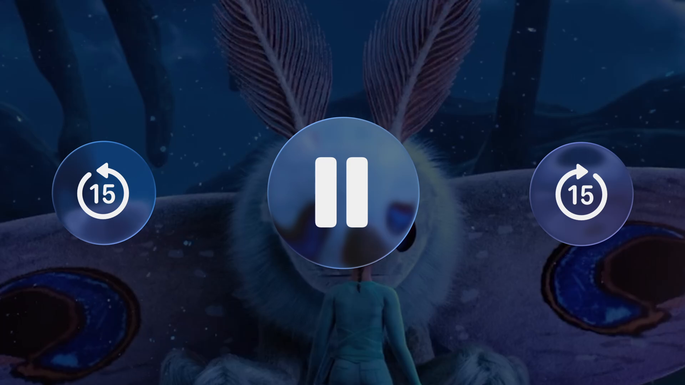

Apple, [14:25](https://developer.apple.com/videos/play/wwdc2025/219/?time=865). This is additional role evidence, not a scored reconstruction: the moving, covered video background has not been recovered independently. Defocus already present in the media must not be counted as glass blur.

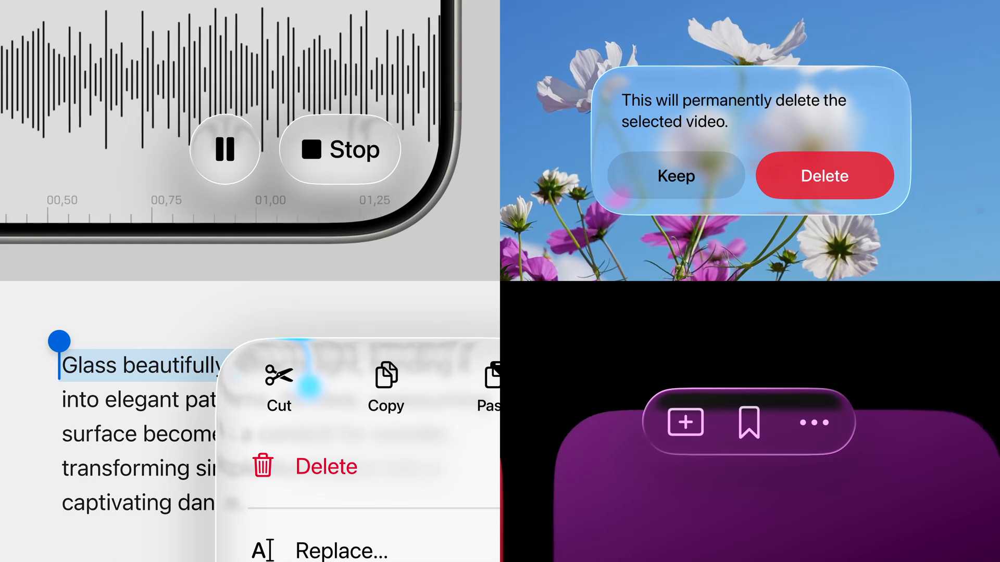

Apple, [14:10](https://developer.apple.com/videos/play/wwdc2025/219/?time=850). These examples show why a universal clear-or-frosted setting is insufficient. Their covered backgrounds and system settings are not all known, so they are not assigned numerical refraction scores.

</details>

## Measurements

<!-- SCORE_TABLE -->

| Scene | No refraction RMSE | Starting optics RMSE | Fitted RMSE | Rim RMSE | Withheld RMSE | SSIM | Source σ |
| --- | ---: | ---: | ---: | ---: | ---: | ---: | ---: |
| Playback | 10.98 | 18.99 | 8.60 | 11.68 | 9.20 | 0.9438 | 0.5 |
| Archive / plus | 9.67 | 9.28 | 7.93 | 10.95 | 8.35 | 0.9630 | 8 |
| Active slider | 11.70 | 10.21 | 5.92 | 7.73 | 6.81 | 0.9811 | 0 |
| Regular light | 1.53 | 1.53 | 1.53 | 2.90 | 1.54 | 0.9991 | 0 |
| Regular dark | 0.87 | 0.87 | 0.87 | 1.66 | 0.89 | 0.9997 | 0 |

<!-- /SCORE_TABLE -->
Errors use encoded RGB channels on a 0–255 scale, only within the glass mask. Lower RMSE is better; higher SSIM is better. These values are not percentages of fidelity. All optical hypotheses receive the same material-fitting freedom and role-specific blur limits.

- The first 0.75 pixel inward from the silhouette and all foreground-symbol boxes are excluded. The rim region is the first 20% of the shorter half-extent, independent of a fitted profile's band.
- Gold 32-pixel blocks are omitted from fitting. They share the same frame, source estimate and manually chosen outline, and have been inspected during development; they are **not independent-scene validation**.
- Model selection uses weighted training loss. Whole-mask error, rim error and visible structure must all be reviewed; smoothing a mismatch can lower a score while worsening the reconstruction.
- The final selection objective uses the same 6,500 native training pixels after 4 × 4 integration for every candidate. Search losses from different sampling/lighting stages are not compared directly. A separate outer-rim score covers the first four pixels; opponent-channel error measures color mismatch.
- SSIM uses mean encoded RGB, an 11 × 11 Gaussian window and an eroded mask. Full MAE, gradient error, counts, parameters and source metadata are in [results.json](experiments/reconstruction/results.json).
- [Sensitivity records](experiments/reconstruction/sensitivity.json) include ±1-pixel source shifts and sampled Jacobians. Strong fits can reverse local source orientation near the rim. Such folds can resemble inverted detail, but are not validated for stable animation.

<details>
<summary>Constrained field comparisons</summary>

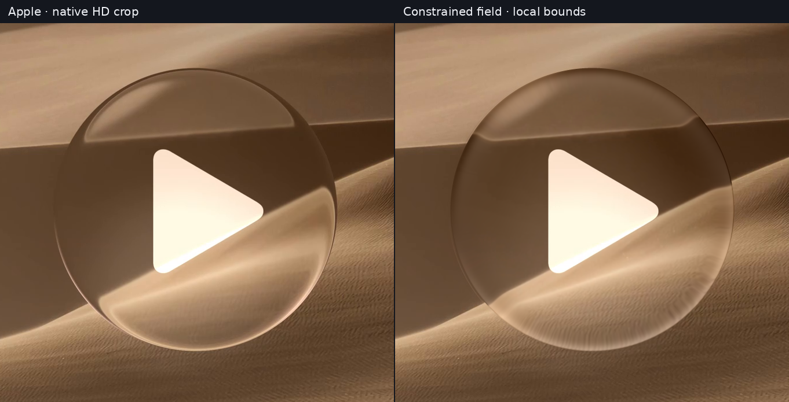

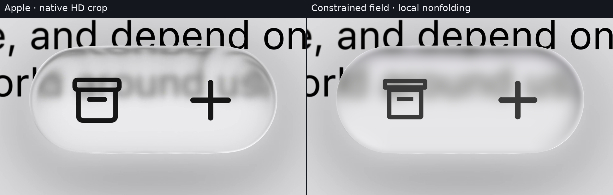

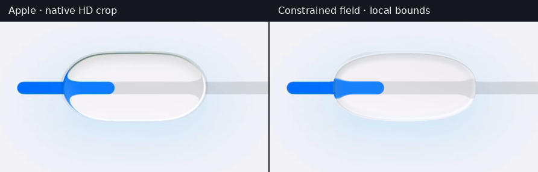

The field uses the [sufficient local orientation bounds](model.md#jacobian-and-folds) at unit power. The slider additionally depends on the assumed oval and numerical minimum-curvature estimate. These constraints do not establish global one-to-one mapping, arbitrary-motion safety or Apple fidelity.

</details>

## Method

- **Inputs:** original 1920 × 1080 Apple downloads at 30000/1001 fps. No upscaled thumbnail, social-media repost or generated reference is used. Exact hashes and URLs: [sources.json](experiments/reconstruction/sources.json). Video compression/presentation processing remain limitations.
- **Recovery:** exterior SIFT/RANSAC features register the uncovered dune and text frames. Page fields are robust degree-four RGB fits to uncovered, text-free pixels. Recovered text is composed over the target field, avoiding a constant-colored insertion. The slider's page is observed before contact; its covered track endpoint is inferred.
- **Geometry:** circle/rounded-rectangle distances for playback/toolbar; numerical distance and analytic implicit normals for the slider's fitted polynomial oval. [contour.py](experiments/reconstruction/contour.py) extracts the upper dark ridge and fits on two-thirds of 81 columns. This fixes a visible mask/outline error; earlier slider scores using the old silhouette are not directly comparable. Geometry stays fixed during subsequent optical fitting. A 2D outline does not identify a unique 3D body.
- **Optics:** [field/cap equations](model.md), flexible boundary profiles, tensor/gradient-potential maps and smooth-height Snell comparators. No per-pixel displacement image is fitted. A good image-field fit does not establish a consistent physical solid.
- **Sampling:** searches now draw from the complete native pixel grid. The former every-second-pixel lattice missed much of the slider's one-pixel dark upper line. Refined searches integrate 2 × 2 subpixels; final renders integrate 4 × 4 for material and coverage in bounded-memory strips. Linear material features are averaged before regression, including their sample/lighting products. This is separate from Gaussian scattering and perceived blur after lens magnification.
- **Scattering:** media σ is restricted to 0–0.5 pixel; the active slider to zero. The toolbar blends clear and blurred samples using a smooth distance-to-boundary weight, with core σ limited to 8 pixels and a fitted 2–30-pixel transition. The light/dark references use zero blur because their fields cannot constrain it.
- **Material:** separate rim/core RGB gains, RGB offsets and low-order lighting, with bounded least squares and a weak numerical ridge. The field/cap/surface controls have 23 coefficients; first-/second-order RGB environments have 26/41. Signed lighting-basis coefficients may reach ±4 because the old ±0.8 ceiling clipped reflected-environment fits; gains remain 0.05–1.5 and offsets ±0.8. Fixed optical candidates receive the same final material refit before selection. Different lighting bases/counts remain a model-complexity confound. Operations use encoded RGB, not physical radiance.
- **Compositing:** the 10-pixel contact band uses the recovered source plus a Gaussian-normalized exterior residual estimated outside the dilated lens. This removes old-reference rim fragments rather than drawing a new outline beside them. Farther exterior remains shared. The band is unscored and is not a validated shadow reconstruction.
- **Lighting basis:** baseline controls retain three Gaussian distance bands with constant/X-normal/Y-normal terms. Surface-reflection controls instead evaluate Fresnel-weighted low-order environments in the reflected direction, using the transmission surface's normal. Spectral controls also vary entry Fresnel factors by representative wavelength. These remain fitted approximations, not Apple's recovered lighting system or full spectral transport.
- **Search:** fixed seeds, differential evolution and three bounded Powell rounds per restart. The outer four pixels receive 2.5× residual weight, the rest of the rim 1.3× and the interior 1×. [refine.py](experiments/reconstruction/refine.py) retains restart evidence; [audit.py](experiments/reconstruction/audit.py) standardizes fixed-map material comparisons and records diagnostics. Historical search stages used different weights/bounds; their losses are development records, not a common ranking. Local minima and bound hits remain possible.
- **Scope:** Apple design demonstrations do not establish their private pipeline. The UIKit slider is a recorded app demonstration. Both physical interpretation and cross-scene transfer remain hypotheses.

## Reproduce

Python 3.11+, NumPy, SciPy, OpenCV and Pillow. Recorded environment: NumPy 2.4.6, SciPy 1.17.1, OpenCV 5.0.0, Pillow 13.0.0, Linux DejaVu Sans. Captions can vary with fonts; numeric scores do not use them.

Download the two HD videos in the [manifest](experiments/reconstruction/sources.json) privately as `219-hd.mp4` and `284-hd.mp4`. Hashes and decoded dimensions are checked. From the repository root:

```sh
python3 docs/liquid-glass/experiments/reconstruction/verify.py
python3 docs/liquid-glass/experiments/reconstruction/reproduce.py /private/videos /private/results
python3 docs/liquid-glass/experiments/reconstruction/audit.py /private/videos /private/results
python3 docs/liquid-glass/experiments/reconstruction/publish.py /private/results docs/liquid-glass/assets --sources /private/videos
python3 docs/liquid-glass/experiments/reconstruction/sensitivity.py /private/results
```

The default replay uses committed parameters. `--fit` searches again; `--case` and `--model` limit the search. For repeated curvature searches, run `refine.py /private/results --case regular --model tensor --restarts 2 --subpixels 2`, then `audit.py /private/videos /private/results --refit` and republish. Optimization can find another minimum. Use a fresh output directory for independent replays; retain the previous study's fixed-map outputs when comparing versions.

Verification covers portable mappings, known scoring errors/exclusions, constrained parameters, continuous-oval geometry, spline endpoint/zero-power limits, background-field recovery and material contrast endpoints. Tool correctness and image similarity are separate checks.

## Attribution and limits

Apple excerpts © Apple Inc., reproduced for attributed rendering analysis. Reference symbols and exterior context remain Apple imagery; only the computed glass material is a Localica reconstruction. Source videos, Apple fonts and private user references are not bundled.

The remaining calibration requires independently recovered backgrounds, multiple sizes and contact states, exterior-shadow reconstruction, temporal stability and physical-device measurements. A close still-image fit alone cannot establish those properties.
