# Apple reference recreations

Primary comparisons open with a centered **Wipe** divider: Apple on the left, reconstruction on the right. Drag the divider or use its arrow keys; **Side by side** shows the original pair. Full-size figures and motion remain in the dropdowns. The clear playback control is the **current most-polished model**. These offline results are separate from the live lab and Android app.

[Mathematical specification](recreation-models.md) · [Parameters](experiments/reconstruction/recipes.json) · [Scores](#scores) · [Reproduce](#reproduce) · [Material roles](#material-roles) · [Guide](README.md)

[Playback](#clear-playback-control) · [Toolbar](#archive-and-plus-toolbar) · [Slider](#active-slider) · [Light/dark](#light-and-dark-surfaces) · [Apple Music](#apple-music-studies) · [Switch](#active-switch)

## Clear playback control

Apple, [Meet Liquid Glass, 3:10](https://developer.apple.com/videos/play/wwdc2025/219/?time=190); uncovered photograph at 3:00. The selected radial map has a quiet center, stronger rim refraction and slight filtering after refraction. The play symbol's calculated color is blurred internally before sharp triangular coverage is applied.

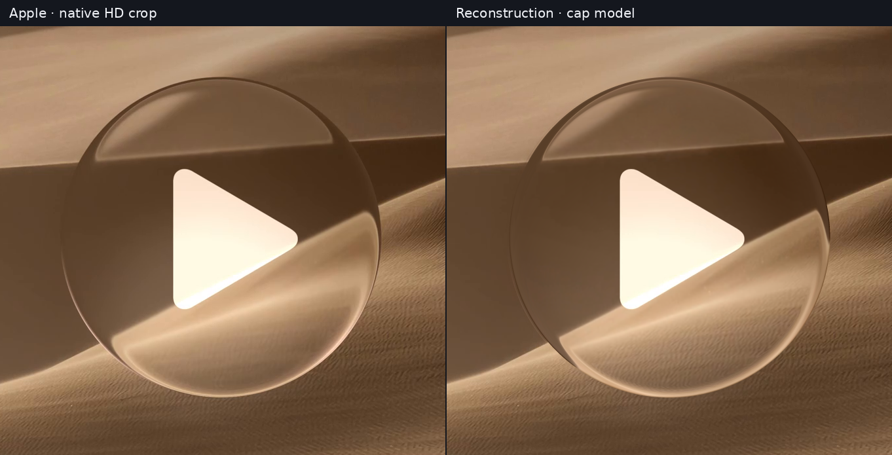

- **Most polished:** width multiplier 4.5; gain 1; source/glass/icon blur σ respectively `0.5/490`, `1.5/490`, `3/490` times the shorter dimension. Dark saturation 0.2; highlight taper 0.5. All lengths, including lighting, scale with the element.
- [Complete equations and operation order](recreation-models.md#playback-radial-map-and-smooth-inner-transition). This is an empirical refraction map, not an identified Apple solid.
- The reference-derived triangle silhouette is reused; its **color is independently calculated**. It has no stroked outline. The response is photograph-specific, not a universal contrast algorithm.
- Distant exterior is retained; the contact band is estimated. Exterior shadows are not scored.

<details>
<summary>Full-resolution playback comparison</summary>

[](assets/match-media-full.png)

Each half retains 1920 × 1080 pixels.

</details>

<details>
<summary>Motion preview — full-size GIF and video</summary>

<video controls preload="none" playsinline width="1920" height="1080" aria-label="Settled playback control motion"><source src="assets/playback-settled.mp4" type="video/mp4"><a href="assets/playback-settled.mp4">Open video</a></video>

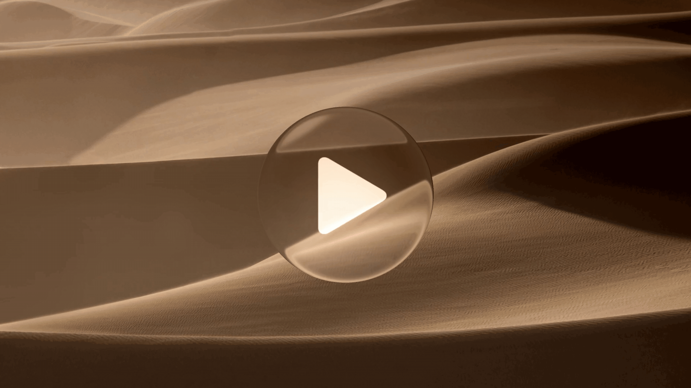

[Full-HD video](assets/playback-settled.mp4). GIF: 7,960,291 bytes, 1920 × 1080, six seconds, 15 fps; video: 30 fps. Translation uses the same recipe without exterior shadow. These are offline renders, not device-performance measurements or a matched Apple motion clip.

</details>

## Archive and plus toolbar

Apple, [Meet Liquid Glass, 11:50](https://developer.apple.com/videos/play/wwdc2025/219/?time=710); uncovered text at 12:00. A rounded-rectangle tensor map combines normal displacement with tangential compression, widening text near top/bottom without changing central registration.

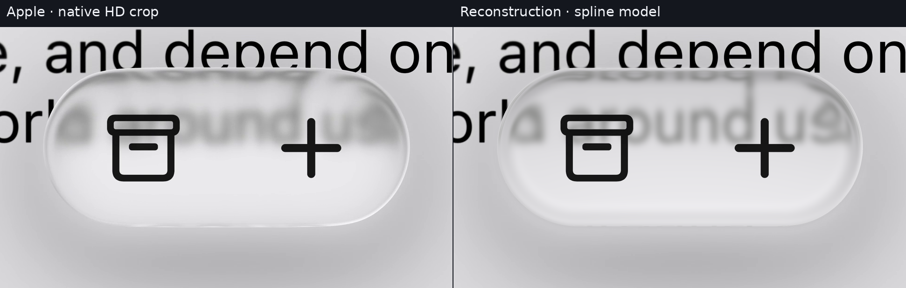

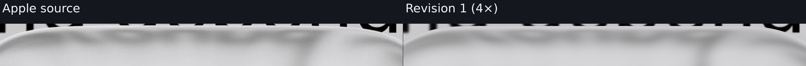

- [Equations](recreation-models.md#toolbar-normal-displacement-and-tangential-compression); exact coefficients in the `regular` recipe.
- Source blur and its distance-dependent blend are independent of optical strength. The selected σ is `11/340` times the shorter dimension, superseding the older eight-pixel search ceiling.
- Exact archive/plus reference symbols are retained on both sides and excluded from glass scores; their foreground rendering is **not** independently recreated.
- Remaining differences include compressed-text blur, the final `d` stroke's curvature and inner lighting. This image field is not a verified physical lens.

<details>
<summary>Full-resolution toolbar comparison</summary>

[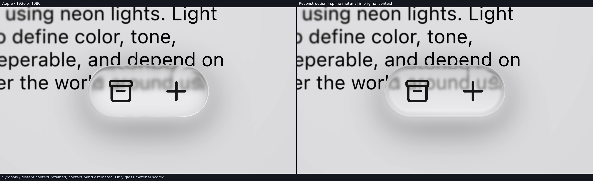](assets/match-regular-full.png)

</details>

## Active slider

Apple, [Build a UIKit app with the new design, 18:12](https://developer.apple.com/videos/play/wwdc2025/284/?time=1092); resting page at 18:10.5. The thumb uses a measured polynomial-oval outline and channel-separated tensor refraction. **No Gaussian blur is applied.**

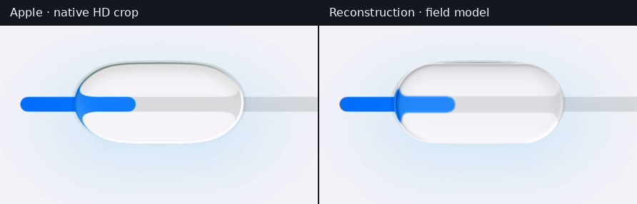

- [Equations](recreation-models.md#active-slider-oval-outline-and-channel-separated-map); exact coefficients in the `slider` recipe. This retains the stronger empirical map; the closed-body trial remains experimental.
- The recovered track has a 20-pixel reference height; its hidden blue endpoint is estimated. The upper dark ridge constrains the outline, with 54 fitted and 27 withheld columns. Bottom/right symmetry remains assumed.
- Colored rim detail supports testing channel-separated lookups, but does not prove dispersion: lighting, adaptive processing and video chroma subsampling are confounds.
- Remaining work: blue-track stretching onset, narrow shadow and broader blue-halo color/extent. The exterior shown is retained/estimated context, **not a recreated shadow**.

<details>
<summary>Full-resolution slider comparison</summary>

[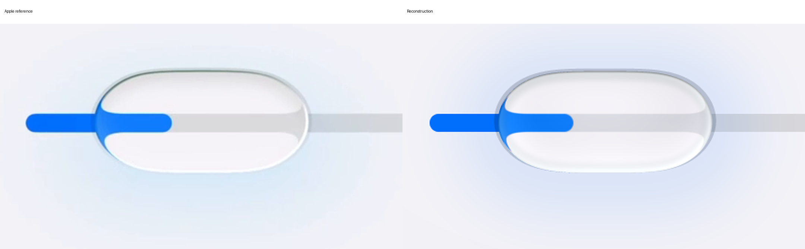](assets/match-slider-full.png)

</details>

## Light and dark surfaces

Apple, [legibility demonstration, 15:15–15:20](https://developer.apple.com/videos/play/wwdc2025/219/?time=915). Each appearance has an independent material recipe over the same shape. [Equations](recreation-models.md#uniform-light-and-dark-surfaces).

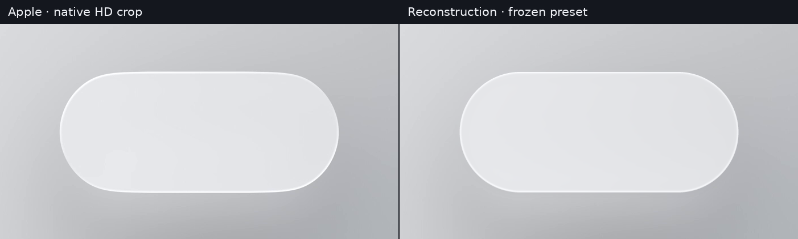

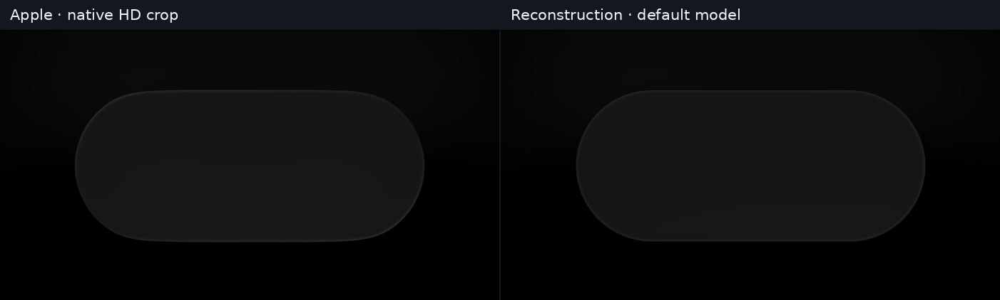

These test tone, broad lighting and rim. Nearly uniform backdrops cannot identify refraction: high similarity here does not validate an optical model. Neither recipe uses Gaussian blur.

<details>
<summary>Full-resolution light and dark comparisons</summary>

[](assets/match-regular-light-full.png)

[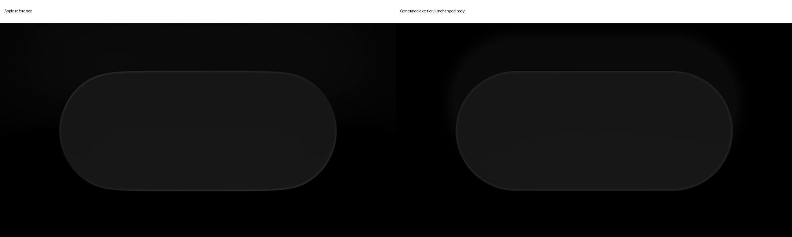](assets/match-regular-dark-full.png)

</details>

## Apple Music studies

References come from [Apple's original Music video](https://www.apple.com/newsroom/videos/2025/autoplay/06/apple-introduces-a-delightful-and-elegant-new-software-design/apple-wwdc25-liquid-glass-apple-music-dynamic-tab-bars/large_2x.mp4). Each study shares optics/material across two observed backgrounds. The reconstruction halves are evaluated at **4× resolution**, including fresh vector coverage; the Apple halves retain the original video's detail. Use **Full image** for the original full-size pair.

### Expanded mini-player

Frame A: 0 seconds. Frame B: 6.033 seconds. Cover art is a separate high-resolution image; symbols and labels use vector geometry. Recovered background strips and registration limits are recorded with the measurements.

[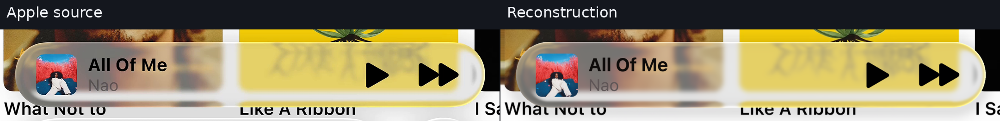](assets/study-music-mini-expanded-vector-paired-a.png)

[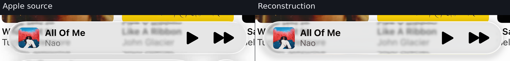](assets/study-music-mini-expanded-vector-paired-b.png)

- [Shared recipe](experiments/reconstruction/studies/music-mini-expanded-vector/paired/accepted.json) · [Verification](experiments/reconstruction/studies/music-mini-expanded-vector/paired/verification.json) · [A diagnostics](experiments/reconstruction/studies/music-mini-expanded-vector/paired/a/diagnostics.json) · [B diagnostics](experiments/reconstruction/studies/music-mini-expanded-vector/paired/b/diagnostics.json).
<details>
<summary>Motion — background A</summary>

<video controls preload="none" playsinline width="5440" height="1000" aria-label="Expanded mini-player, background A motion"><source src="assets/study-music-mini-expanded-vector-paired-a.mp4" type="video/mp4"><a href="assets/study-music-mini-expanded-vector-paired-a.mp4">Open video</a></video>


[Video](assets/study-music-mini-expanded-vector-paired-a.mp4) · [GIF](assets/study-music-mini-expanded-vector-paired-a.gif)

</details>

<details>
<summary>Motion — background B</summary>

<video controls preload="none" playsinline width="5440" height="1000" aria-label="Expanded mini-player, background B motion"><source src="assets/study-music-mini-expanded-vector-paired-b.mp4" type="video/mp4"><a href="assets/study-music-mini-expanded-vector-paired-b.mp4">Open video</a></video>

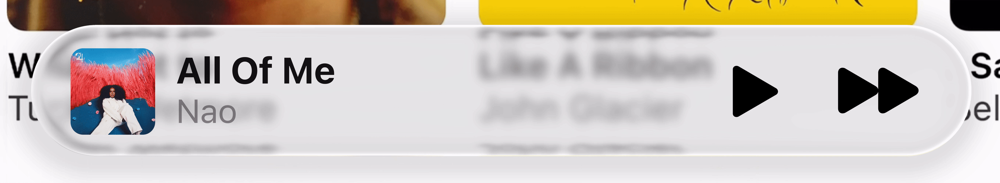

[Video](assets/study-music-mini-expanded-vector-paired-b.mp4) · [GIF](assets/study-music-mini-expanded-vector-paired-b.gif)

</details>

### Compact mini-player

Frames A/B: 2.5/2.0 seconds. This tests the compact state of the same playback component. The exterior mask remains fixed while the silhouette is refined; it cannot move to conceal shadow error.

[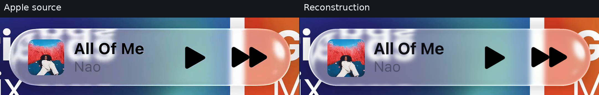](assets/study-music-mini-compact-vector-paired-a.png)

[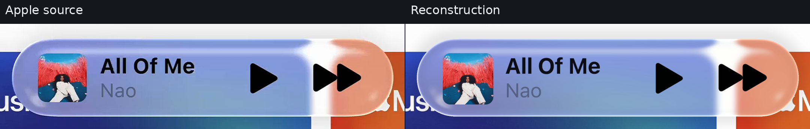](assets/study-music-mini-compact-vector-paired-b.png)

- [Shared recipe](experiments/reconstruction/studies/music-mini-compact-vector/paired/accepted.json) · [Verification](experiments/reconstruction/studies/music-mini-compact-vector/paired/verification.json) · [A diagnostics](experiments/reconstruction/studies/music-mini-compact-vector/paired/a/diagnostics.json) · [B diagnostics](experiments/reconstruction/studies/music-mini-compact-vector/paired/b/diagnostics.json).
<details>
<summary>Motion — background A</summary>

<video controls preload="none" playsinline width="3680" height="960" aria-label="Compact mini-player, background A motion"><source src="assets/study-music-mini-compact-vector-paired-a.mp4" type="video/mp4"><a href="assets/study-music-mini-compact-vector-paired-a.mp4">Open video</a></video>

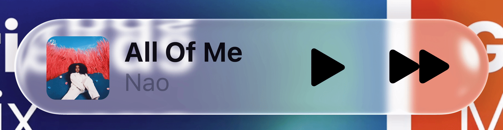

[Video](assets/study-music-mini-compact-vector-paired-a.mp4) · [GIF](assets/study-music-mini-compact-vector-paired-a.gif)

</details>

<details>
<summary>Motion — background B</summary>

<video controls preload="none" playsinline width="3680" height="960" aria-label="Compact mini-player, background B motion"><source src="assets/study-music-mini-compact-vector-paired-b.mp4" type="video/mp4"><a href="assets/study-music-mini-compact-vector-paired-b.mp4">Open video</a></video>

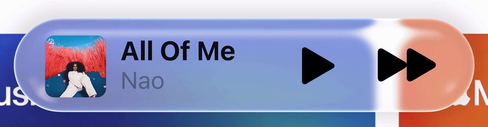

[Video](assets/study-music-mini-compact-vector-paired-b.mp4) · [GIF](assets/study-music-mini-compact-vector-paired-b.gif)

</details>

### Detached Search control

Frames A/B: 2.5/2.0 seconds. The magnifier is a clean symmetric vector trace; color and opacity are fitted separately. The icon geometry does not contain video compression artifacts.

[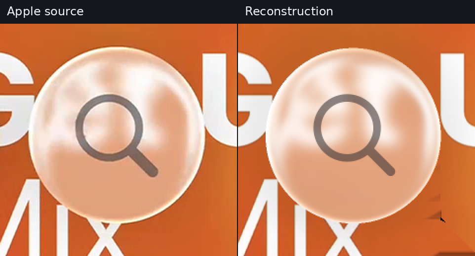](assets/study-music-search-vector-paired-a.png)

[](assets/study-music-search-vector-paired-b.png)

- [Shared recipe](experiments/reconstruction/studies/music-search-vector/paired/accepted.json) · [Verification](experiments/reconstruction/studies/music-search-vector/paired/verification.json) · [A diagnostics](experiments/reconstruction/studies/music-search-vector/paired/a/diagnostics.json) · [B diagnostics](experiments/reconstruction/studies/music-search-vector/paired/b/diagnostics.json).
<details>
<summary>Motion — background A</summary>

<video controls preload="none" playsinline width="960" height="940" aria-label="Search control, background A motion"><source src="assets/study-music-search-vector-paired-a.mp4" type="video/mp4"><a href="assets/study-music-search-vector-paired-a.mp4">Open video</a></video>

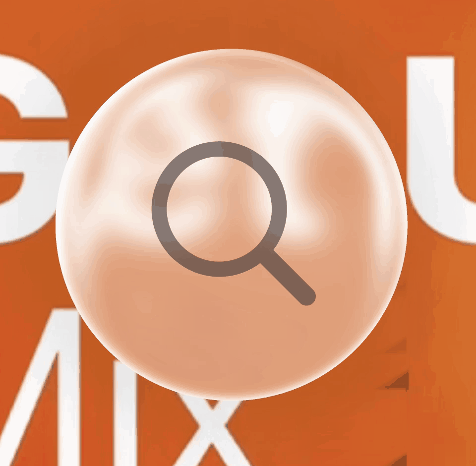

[Video](assets/study-music-search-vector-paired-a.mp4) · [GIF](assets/study-music-search-vector-paired-a.gif)

</details>

<details>
<summary>Motion — background B</summary>

<video controls preload="none" playsinline width="960" height="940" aria-label="Search control, background B motion"><source src="assets/study-music-search-vector-paired-b.mp4" type="video/mp4"><a href="assets/study-music-search-vector-paired-b.mp4">Open video</a></video>

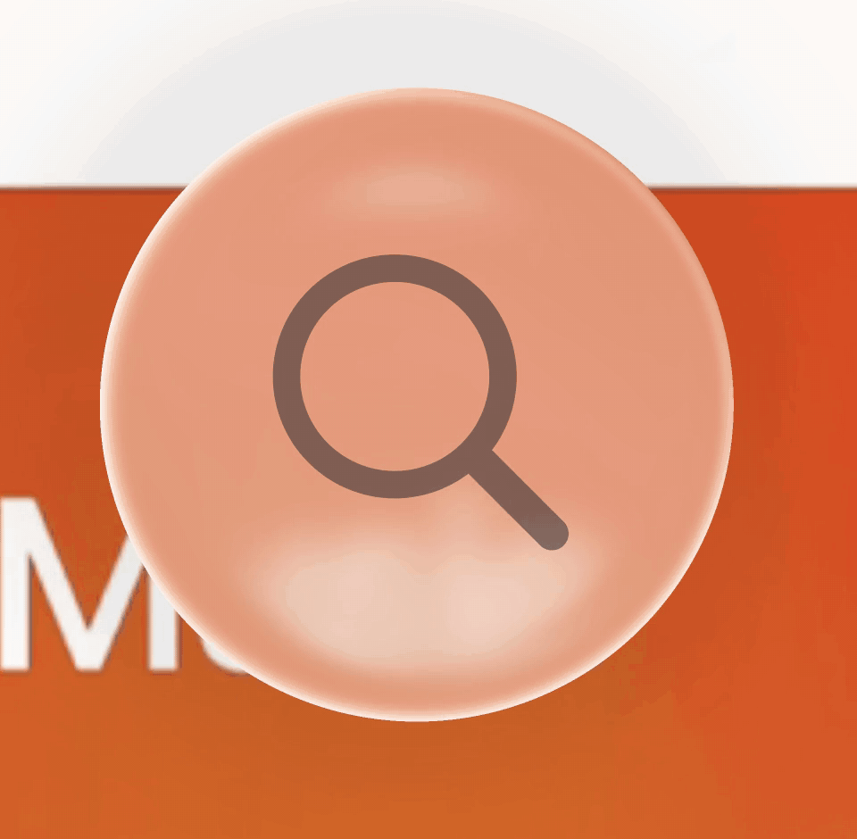

[Video](assets/study-music-search-vector-paired-b.mp4) · [GIF](assets/study-music-search-vector-paired-b.gif)

</details>

### Navigation control

Frames A/B: 0/6.033 seconds. The study separates the outer glass, fixed gray selection backing, symbols and text. Original font outlines are used for labels; unresolved symbols use clean traces or a documented public vector. **The upper rim on B remains too dark.** The mostly white background A weakly constrains refraction.

[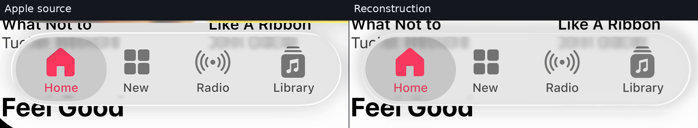](assets/study-music-navigation-paired-a.png)

[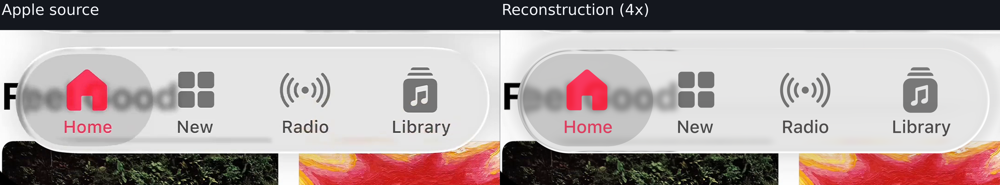](assets/study-music-navigation-paired-b.png)

- [Shared recipe](experiments/reconstruction/studies/music-navigation/paired/accepted.json) · [Verification](experiments/reconstruction/studies/music-navigation/paired/verification.json) · [A diagnostics](experiments/reconstruction/studies/music-navigation/paired/a/diagnostics.json) · [B diagnostics](experiments/reconstruction/studies/music-navigation/paired/b/diagnostics.json).
<details>
<summary>Motion — background A</summary>

<video controls preload="none" playsinline width="4320" height="1340" aria-label="Navigation control, background A motion"><source src="assets/study-music-navigation-paired-a.mp4" type="video/mp4"><a href="assets/study-music-navigation-paired-a.mp4">Open video</a></video>

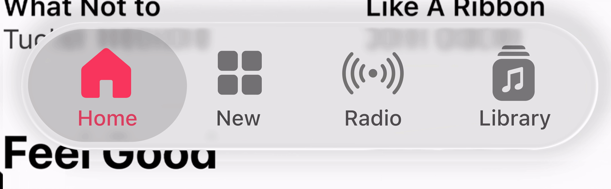

[Video](assets/study-music-navigation-paired-a.mp4) · [GIF](assets/study-music-navigation-paired-a.gif)

</details>

<details>
<summary>Motion — background B</summary>

<video controls preload="none" playsinline width="4320" height="1340" aria-label="Navigation control, background B motion"><source src="assets/study-music-navigation-paired-b.mp4" type="video/mp4"><a href="assets/study-music-navigation-paired-b.mp4">Open video</a></video>


[Video](assets/study-music-navigation-paired-b.mp4) · [GIF](assets/study-music-navigation-paired-b.gif)

</details>

### Home control

Frames A/B: 2.5/2.0 seconds. The corrected study has 22 initial/refinement and 21 paired experiments, with one sparse source-brightness response and a clean Home vector. Both references pass the frozen native loss, whole-glass and foreground gates. The earlier pairing regressed the first-background result; its unchanged archived records do not count as current acceptance.

[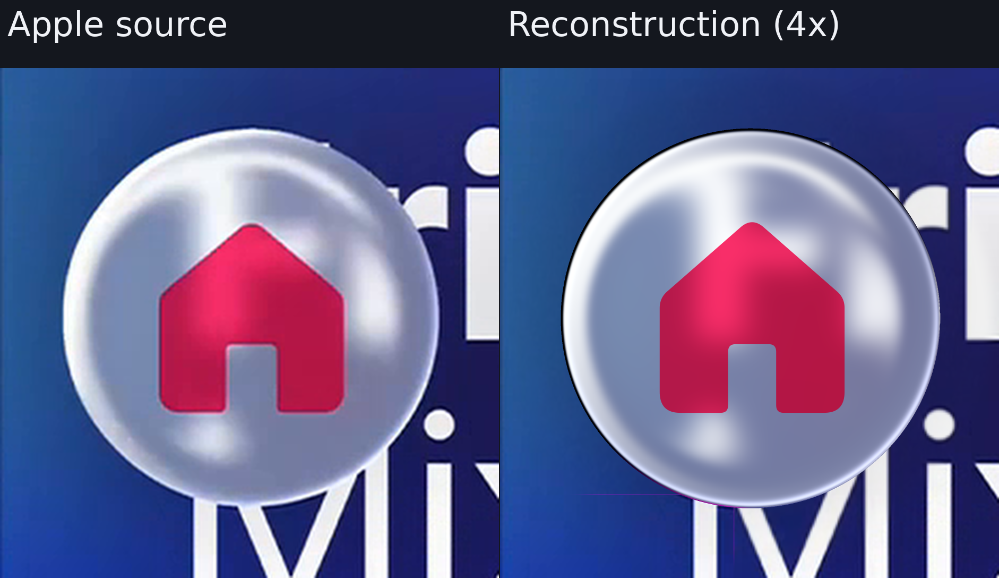](assets/study-music-home-vector-progress-a.png)

[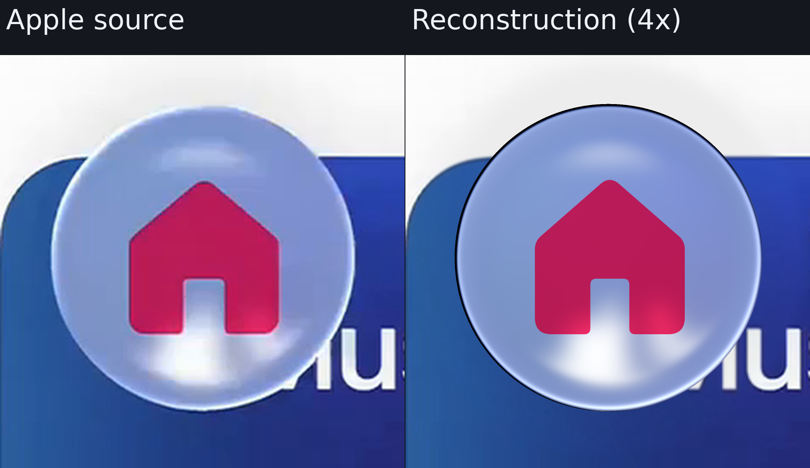](assets/study-music-home-vector-progress-b.png)

- [Recipe](experiments/reconstruction/studies/music-home-vector/paired/accepted.json) · [Single-to-paired boundary](experiments/reconstruction/studies/music-home-vector/paired/bridge.json) · [Independent native replay](experiments/reconstruction/studies/music-home-vector/paired/verification.json) · [Archived invalid chain](experiments/reconstruction/studies/music-home-vector/paired-invalid-boundary/status.json).
- A 0.08L inset keeps the source-color calculation on defined pixels. A narrow uniform-white incident field improves the outer contour; it is an empirical lighting assumption, and a dark upper-rim mismatch remains. The source-brightness law is tested only over these two backgrounds.
- These 4× captures show pass21. Missing background pixels are extended with nearby defined RGB for presentation, with [measured benchmark differences](experiments/reconstruction/home-gallery-progress.json). Motion uses the same completed, translated source inside and outside the lens; the extension is not photographic recovery. Four-second videos run at 30 fps; full-size GIFs stay below 10 MB by reducing frame rate.

<details>
<summary>Motion — background A</summary>

<video controls preload="none" playsinline width="940" height="960" aria-label="Home correction, background A motion"><source src="assets/study-music-home-vector-paired-a.mp4" type="video/mp4"><a href="assets/study-music-home-vector-paired-a.mp4">Open video</a></video>

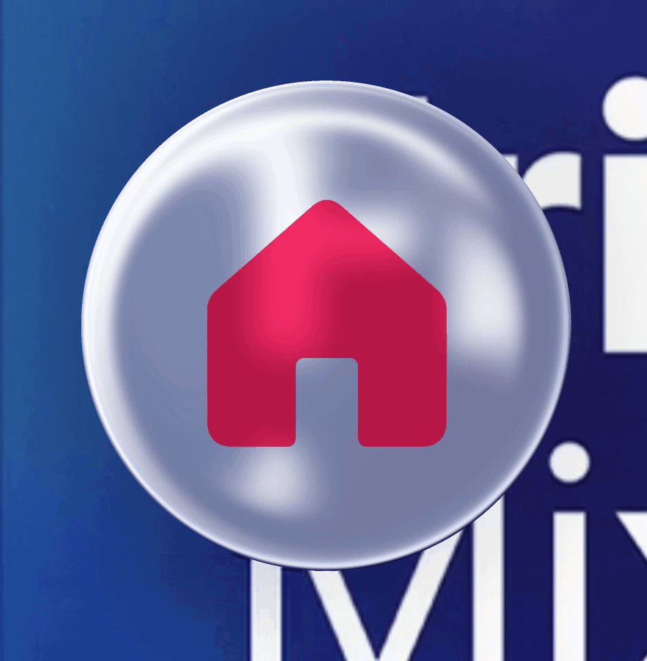

[Video](assets/study-music-home-vector-paired-a.mp4) · [GIF](assets/study-music-home-vector-paired-a.gif)

</details>

<details>
<summary>Motion — background B</summary>

<video controls preload="none" playsinline width="940" height="960" aria-label="Home correction, background B motion"><source src="assets/study-music-home-vector-paired-b.mp4" type="video/mp4"><a href="assets/study-music-home-vector-paired-b.mp4">Open video</a></video>


[Video](assets/study-music-home-vector-paired-b.mp4) · [GIF](assets/study-music-home-vector-paired-b.gif)

</details>

## Active switch

Frames A/B: 9.4/10.5 seconds in [Apple's Details video](https://www.apple.com/newsroom/videos/2025/autoplay/06/apple-introduces-a-delightful-and-elegant-new-software-design/apple-wwdc25-liquid-glass-details/large_2x.mp4). The shared calibration includes 24 initial and 24 paired experiments. These **4× comparisons** use one signed image map and material, with the measured pose/size of each thumb.

[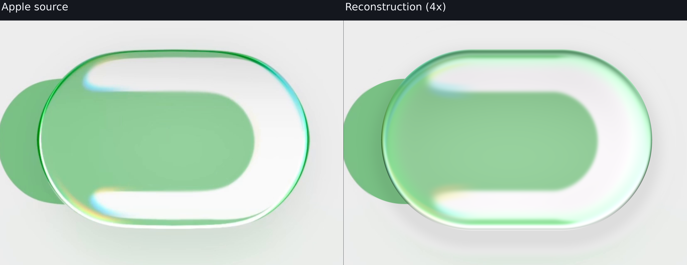](assets/study-active-switch-paired-a.png)

[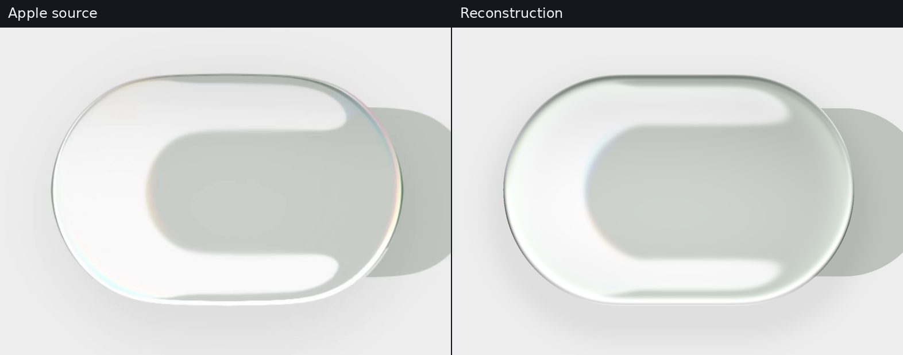](assets/study-active-switch-paired-b.png)

- The hidden track is an explicit symmetric, uniform-color estimate. Defined source coverage is distinct from directly observed pixels; scores are conditional on that estimate.
- A shared source-color rule reduces the material’s green cast on neutral backgrounds without desaturating refracted RGB detail. Directional channel separation reproduces part of the inner fringe; upper-rim color and edge shape remain incomplete; there is no claim of a recovered Apple solid.
- [Current recipe and pass records](experiments/reconstruction/studies/active-switch/paired/accepted.json) · [Snapshot measurements](experiments/reconstruction/switch-gallery-progress.json) · [Study PR #425](https://github.com/anastaci1a/localica/pull/425). [Native paired replay](experiments/reconstruction/studies/active-switch/paired/verification.json) verifies all 24 paired passes. Both motion captures show pass24. The 4× masters are four seconds at 30 fps; GIF previews are half-size at 15 fps and under 10 MB.

<details>
<summary>Motion — green track</summary>

<video controls preload="none" playsinline width="3300" height="2360" aria-label="Active switch on green track motion"><source src="assets/study-active-switch-paired-a.mp4" type="video/mp4"><a href="assets/study-active-switch-paired-a.mp4">Open video</a></video>

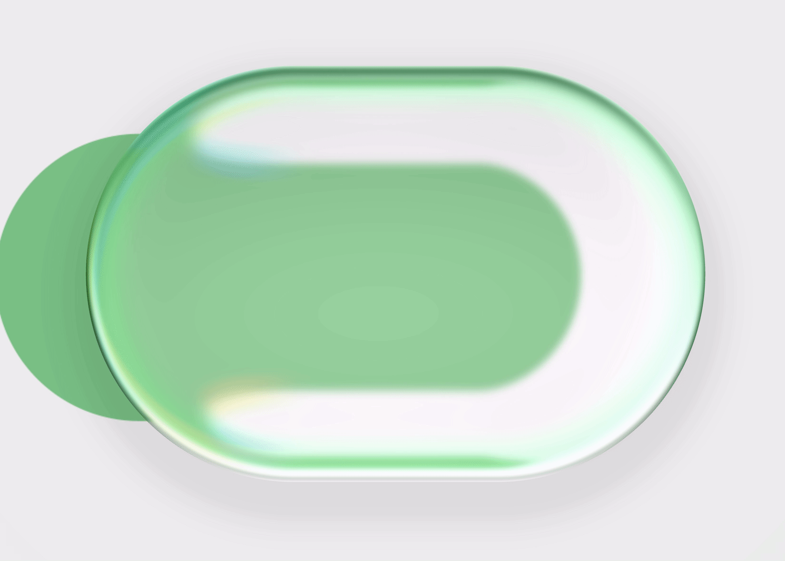

[Video](assets/study-active-switch-paired-a.mp4) · [GIF](assets/study-active-switch-paired-a.gif) · [Encoding checks](experiments/reconstruction/studies/active-switch/paired/a/media.json) · [GIF checks](experiments/reconstruction/studies/active-switch/paired/a/gif-qa.json). Video is evaluated at 4×; the GIF uses half-size frames. This illustrates backdrop movement, not measured Apple interaction timing.

</details>

<details>
<summary>Motion — gray track</summary>

<video controls preload="none" playsinline width="3140" height="2280" aria-label="Active switch on gray track motion"><source src="assets/study-active-switch-paired-b.mp4" type="video/mp4"><a href="assets/study-active-switch-paired-b.mp4">Open video</a></video>

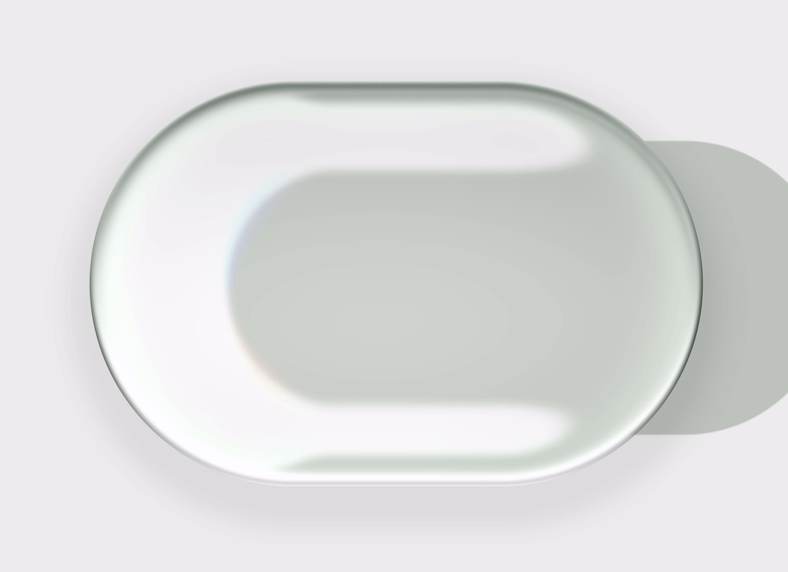

[Video](assets/study-active-switch-paired-b.mp4) · [GIF](assets/study-active-switch-paired-b.gif) · [Encoding checks](experiments/reconstruction/studies/active-switch/paired/b/media.json) · [GIF checks](experiments/reconstruction/studies/active-switch/paired/b/gif-qa.json). Same shared model and normalized travel as the green-track capture.

</details>

### Colored switch rim

Each crop below places Apple on the left and snapshot 24 on the right. The gray-track reference contains a warm patch near RGB `(251,236,209)` and a cyan lower rim. The estimated track itself is near `(190,195,189)`. Those hue changes require investigation beyond ordinary shared-channel sampling of that estimate.

[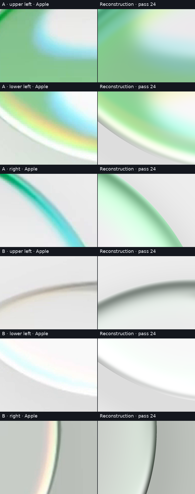](assets/switch-rim-detail.png)

- A source-derived directional reflection reduces the unsupported dark inner contour at A/B lower left, independently of the exterior shadow. The supplementary lower-contour MSE falls from7511/10205 to1124/1688; native masks stay fixed. Thin inner colored bands at A lower left and B right remain calibration targets.
- [Rim measurements](experiments/reconstruction/switch-rim-analysis.json) include native RGB samples, resting controls and source assumptions. [Competing color models](experiments/reconstruction/switch-color-hypotheses.json) test channel-separated rays and directional chromatic lighting. Some improve native scores slightly; none reproduces the broad colored bands, and none is adopted. Their frozen baselines differ and are recorded separately.
- Apple describes separate [geometry-dependent highlights and ambient color spill](https://developer.apple.com/videos/play/wwdc2025/219/?time=631). Colored transmission, lighting/tint, video processing and source-estimation error remain possible contributors; these pixels do not identify physical dispersion or an exact Apple shader.

## Active segmented selector

Single-reference pass 2. Weighted loss 526.474; glass RMSE 24.111 The source is Apple's Details video at 16.4 seconds. The earlier13 source-biased passes are [archived and excluded](experiments/reconstruction/studies/active-segmented-selector/invalid-track-registration/status.json); the corrected source is constrained by both distant track ends. An [intermediate caption proxy](experiments/reconstruction/studies/active-segmented-selector/invalid-lensed-caption-proxy/status.json) is also excluded; current caption geometry uses only independently unoccluded labels. A second observed position at 16.5 seconds is reserved for paired calibration; no paired acceptance is claimed yet.

[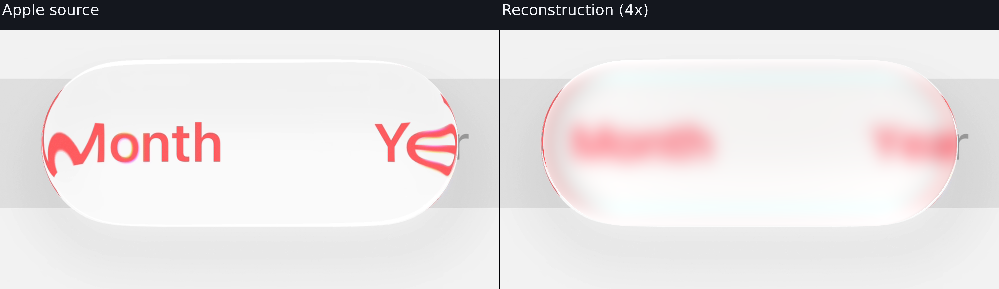](assets/study-active-segmented-selector-progress-a.png)

- The incident texture uses solid SF font outlines with selected red text; the exterior retains gray text. Hidden track geometry, font choice, recoloring before refraction and layout transfer are explicit estimates, not photographic recovery or a claim about Apple's rendering pipeline.
- [Current native measurements and source limits](experiments/reconstruction/active-segmented-selector-progress.json) · [Recipe and pass records](experiments/reconstruction/studies/active-segmented-selector/accepted.json). The reconstruction panel is evaluated at 4×; native scoring remains fixed.

## Scores

### Music and switch studies

| Study | Weighted loss A / B | Glass RMSE A / B | Initial / paired passes | Status |
| --- | ---: | ---: | ---: | --- |
| Expanded mini-player | 29.031 / 9.723 | 4.366 / 2.571 | 22 / 21 | Completed study |
| Compact mini-player | 24.899 / 23.369 | 4.370 / 4.325 | 29 / 21 | Completed study |
| Search | 52.284 / 50.753 | 6.794 / 6.592 | 28 / 21 | Completed study |
| Navigation | 3.916 / 55.270 | 1.611 / 6.044 | 20 / 24 | Completed study; rim mismatch |
| Home | 40.187 / 103.246 | 5.861 / 9.223 | 22 / 21 | Corrected boundary verified |
| Active switch, pass 24 | 232.758 / 276.129 | 12.061 / 14.677 | 24 / 24 | Paired calibration |

- Weighted loss is `0.7 × glass RMSE² + 0.3 × rim RMSE²`; each sample's loss and whole-glass RMSE must hold or improve. Rejected experiments retain the incumbent. Independent replay also checks that the first paired baseline protects the retained single-background result.
- These studies use two samples per output axis and fixed native-reference masks. They are not directly ranked against the earlier four-sample-per-axis studies below. Foreground errors and source-footprint diagnostics remain separate from glass scores.
- Both references come from the same video, not independent device validation. Higher-resolution presentation does not create new source detail or change native scoring. GIFs may have lower resolution/frame rate than the 4× PNG/video masters; their encoding diagnostics are recorded with each study.

### Earlier HD studies

| Scene | Glass RMSE | Rim RMSE | Interior RMSE | Withheld-block RMSE | SSIM |
| --- | ---: | ---: | ---: | ---: | ---: |
| Playback — most polished | 8.077 | 11.148 | 2.626 | 8.368 | 0.9727 |
| Archive / plus | 6.124 | 8.984 | 4.091 | 5.978 | 0.9805 |
| Active slider | 7.227 | 8.850 | 6.566 | 7.445 | 0.9718 |
| Regular light | 1.532 | 2.894 | 0.578 | 1.544 | 0.9991 |
| Regular dark | 0.871 | 1.664 | 0.298 | 0.886 | 0.9997 |

Playback icon-color RMSE: 3.228. Toolbar symbols are retained reference pixels and are not given foreground scores.

- Encoded RGB errors use a 0–255 scale. Lower RMSE is better; higher SSIM is better. **SSIM is not a fidelity percentage.** Scores use unquantized calculated glass; PNG rounding changes them slightly. Full metrics, counts and registration evidence: [settled-scores.json](experiments/reconstruction/settled-scores.json).
- Glass excludes the first 0.75 native pixel inward from the silhouette and symbol boxes. Rim means the first 20% of the shorter half-extent. Exterior shadows are excluded. Only playback has a separately scored, independently calculated foreground color.
- Omitted 32-pixel spatial blocks share the same frame, source estimate and manually chosen outline. They were inspected during calibration and are **not independent-scene validation**. Replay performs no optimization.
- SSIM uses mean encoded RGB, an 11 × 11 Gaussian window and an eroded mask. Registration uncertainty, inferred backdrops and different material freedoms limit cross-scene comparisons.

<details>
<summary>Playback progression, including earlier PR commits</summary>

| Stage | Glass RMSE | Rim RMSE | SSIM | Icon RMSE |
| --- | ---: | ---: | ---: | ---: |
| First published HD fit (7a8061b) | 10.182 | 11.956 | 0.9577 | — |
| Corrected published HD fit (b1636bb) | 8.617 | 11.692 | 0.9434 | — |
| Pass 01 | 8.690 | 11.792 | 0.9477 | — |
| Pass 02 | 8.690 | 11.792 | 0.9477 | 3.497 |
| Pass 03 | 8.690 | 11.792 | 0.9477 | 3.497 |
| Pass 04 | 8.676 | 11.853 | 0.9456 | 3.081 |
| Pass 05 | 8.058 | 11.115 | 0.9738 | 3.195 |
| Pass 06 | 8.070 | 11.138 | 0.9730 | 3.243 |
| Settled final | 8.082 | 11.152 | 0.9724 | 3.244 |

Rows re-score archived **8-bit outputs** using the same glass/rim masks. This differs slightly from the unquantized replay table. Earlier copied icons are unscored. Source/filter/material changes prevent attributing the entire improvement to optics. [Full values and provenance](experiments/reconstruction/progression.json).

</details>

## Material roles

| Context | Evidence and calibration rule |
| --- | --- |
| Media controls over photos/video | Clear preserves detail. Transfer the circular model first to other circular Clear controls; retain proportional filtering and validate foreground contrast. |
| Navigation/toolbars/text | Regular adapts blur/brightness. Fit displacement and scattering separately; uniform blur can conceal inverted rim detail. |
| Larger menus | Size/context can alter appearance; button coefficients need not remain fixed as it becomes a panel. |
| Active slider/switch thumb | Manipulation temporarily reveals a clear lens. This contact state is separate from page material choice. |
| Scroll-edge treatment | Additional effects beneath floating controls may belong to scrolling content rather than glass. |
| Appearance/accessibility | Record settings when known. An unlabeled screenshot does not establish universal defaults. |

Primary sources: [Materials HIG](https://developer.apple.com/design/human-interface-guidelines/materials), [variants/legibility](https://developer.apple.com/videos/play/wwdc2025/219/?time=828), [active controls](https://developer.apple.com/videos/play/wwdc2025/219/?time=250), [size adaptation](https://developer.apple.com/videos/play/wwdc2025/219/?time=360). [Localica material policy](specification.md#surface-roles) owns app implementation decisions.

## Reproduce

Use Python 3.11+ and the [pinned dependencies](experiments/reconstruction/requirements.txt) in a private virtual environment. Linux DejaVu Sans affects captions only. Download original HD videos privately as `219-hd.mp4` and `284-hd.mp4` using [sources.json](experiments/reconstruction/sources.json); replay checks hashes and decoded dimensions.

From the repository root:

```sh
python3 docs/liquid-glass/experiments/reconstruction/verify-recipes.py
python3 docs/liquid-glass/experiments/reconstruction/settled.py /private/videos /private/replay
python3 docs/liquid-glass/experiments/reconstruction/motion.py /private/replay /private/motion
```

The second command renders **all five frozen recipes**, native-resolution outputs and scores. Add `--assets docs/liquid-glass/assets` to update public comparison figures. The third recreates the playback translation video/GIF and requires ffmpeg. Neither refits or modifies the live lab; no GPU is needed. The portable specification is the [equations](recreation-models.md) and [dimensionless parameters](experiments/reconstruction/recipes.json); commands fix one sampling implementation. Codec/library versions can change encoded media bytes.

Background recovery uses SIFT/RANSAC registration for dune/text scenes and smooth uncovered-page fits elsewhere. Inputs are quantized to eight-bit intermediate images to match calibration. Hidden text/track endpoints remain estimates. Still materials integrate four samples per axis; sampling is bilinear, filter boundaries reflect, and coverage is separate.

The play mask contains coverage only. Toolbar glyph colors and distant exterior remain shared Apple imagery. A ten-pixel contact band uses the recovered source plus a normalized low-frequency exterior residual; it is unscored. Motion uses the playback recipe at two samples per axis and omits shadows. Archived MP4/GIF encoding is separate from numerical still replay.

Historical search tools and [results.json](experiments/reconstruction/results.json) retain alternative models; they are **not the selected recipes/current scores**. Search again only in a separate directory. Tool consistency, Apple similarity and Android performance require different checks.

## Attribution and limits

Apple excerpts © Apple Inc., reproduced for attributed rendering analysis. Original frame sizes/rates, URLs and hashes are recorded with each study. Source videos, Apple fonts and private user feedback are not bundled.

Remaining validation: independent scenes, multiple sizes/contact states, temporal stability, reconstructed exterior shadows and device performance. Further lab work is preserved separately; these frozen studies do not replace the deployed lab or native renderer.
